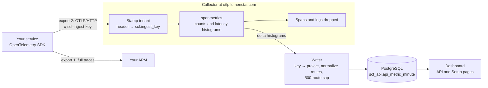

Lumenstat measures how your API is used: requests, status codes and latency for each route, per minute. You send it the same OpenTelemetry spans your APM already receives, through a second exporter. The collector turns server spans into counts and latency histograms and then drops every span, so no trace, log or request body is stored.

## How it works

Your service keeps the exporter it has today and adds one more. The second exporter sends the same spans to `https://otlp.lumenstat.com` with an `x-scf-ingest-key` header. Your APM stores full traces as before. Lumenstat aggregates its copy and discards it.

1. **Tenant stamping.** The collector deletes any `scf.ingest_key` resource attribute the client sent, then copies the `x-scf-ingest-key` request header onto the resource. This runs before aggregation, so spans from two projects are never merged into one series.
2. **spanmetrics.** The collector's spanmetrics connector turns spans into a request count and a latency histogram per service, route attribute, method and status code, and flushes them every 15 seconds as deltas. The traces pipeline has no other exporter, so the spans go nowhere after that. Logs go to a no-op exporter.
3. **Writer.** The writer keeps only the accepted HTTP latency histograms, and of the span-derived ones only those from server spans. It maps the ingest key to your project and ignores any tenant field inside the payload. It normalizes the route, caps each service at 500 routes, moves latency onto fixed millisecond buckets and adds the result to one row per minute.
4. **Dashboard.** The **API** page shows requests, 5xx rate, p50 and p95 latency, and a table per route. **Setup** shows whether data is arriving.

The collector configuration is [`apps/collector/config.yaml`](https://github.com/boundlessfi/lumenstat/blob/main/apps/collector/config.yaml). The writer is in [`apps/writer`](https://github.com/boundlessfi/lumenstat/tree/main/apps/writer). How tenants are kept apart is covered in [Tenant isolation](/trust/tenant-isolation).

## What Lumenstat stores

One row per project, service, route, method, status code, source and minute in `scf_api.api_metric_minute`. That row is everything Lumenstat keeps about your API.

| Field | Comes from |
| --- | --- |
| Project | The ingest key, looked up by its SHA-256 hash |
| Service | Resource attribute `service.name`, first 128 characters, `unknown_service` if missing |
| Route | `http.route`, else `url.path` or `http.target`, normalized. See [Route normalization](/api/routes) |
| Method | `http.request.method` or `http.method`, upper case, `_OTHER` if missing |
| Status code | `http.response.status_code` or `http.status_code`, `0` if missing |
| Source | `spans` or `metrics`, depending on whether the row was built from spans or from SDK metrics |
| Minute | The UTC minute of the data point |
| Request count, total duration | Summed over the minute |
| Latency histogram | 15 counts on fixed buckets from 5 ms to 10 s. See [OTLP ingest](/reference/otlp-ingest#histogram-buckets) |

## What Lumenstat does not store

- Trace IDs, span IDs, span names, span events, exceptions and links.
- Span attributes other than the route, method and status fields above. That includes client IP addresses (`client.address`, `network.peer.address`), user agents, query strings (`url.query`), headers, request and response bodies, and database statements.
- Resource attributes other than `service.name`, such as host names, process IDs and cloud metadata.
- Logs, and metrics other than the three accepted HTTP latency series.

Not stored is not the same as not sent. See [Limits](#limits) for what passes through in transit.

## Issue an ingest key

Each project issues its own keys on the Setup page of the dashboard.

<Steps>
  <Step title="Open Setup">
    Sign in at [app.lumenstat.com](https://app.lumenstat.com), open your project and select **Setup**.
  </Step>
  <Step title="Issue a key">
    In the **API (optional)** card, select **Issue an ingest key**. The first key also creates your project's API tenant. Only the project owner, a project manager or an SCF operator can issue keys.
  </Step>
  <Step title="Copy it now">
    The key starts with `scf_ingest_` and is shown once. Lumenstat stores only its SHA-256 hash and cannot show it again. **Copy settings** copies two environment variable lines with the key filled in.
  </Step>
  <Step title="Store it as a secret">
    Keep the key in your secret store, not in source control. Anyone who holds it can send data that counts toward your project.
  </Step>
</Steps>

**Issue another key** creates an additional key. Earlier keys keep working, so you can roll a new key out before you retire the old one.

<Note>
  The dashboard cannot revoke an ingest key yet. If a key leaks, contact an SCF operator.
</Note>

{/* TODO: confirm how an ingest key is revoked today (the ingest_key table has revoked_at, but no CLI or UI sets it) and which contact channel to name. */}

Then connect your service:

<Columns cols={2}>
  <Card title="Node.js" icon="hexagon" href="/api/node">
    Express or NestJS with the OpenTelemetry Node SDK and a second span exporter.
  </Card>
  <Card title="Collector and other languages" icon="git-fork" href="/api/collector">
    Go, Python, Rust, Java, or any service behind an OpenTelemetry Collector.
  </Card>
</Columns>

## Limits

- **Sampling lowers the counts.** Lumenstat counts the spans it receives. If your SDK or Collector keeps 10% of traces, Lumenstat sees 10% of requests. Send Lumenstat an unsampled copy through a separate Collector pipeline, as shown in [Send only what Lumenstat reads](/api/collector#send-only-what-lumenstat-reads).
- **Spans arrive in full.** Lumenstat stores only the fields above, but the collector receives whole spans and holds them in memory until it aggregates them. In the current pilot `otlp.lumenstat.com` is served through Cloudflare, which sees the requests in transit. To keep attributes inside your network, trim them in your own Collector before export.
- **Keys are checked after aggregation.** The collector does not validate the ingest key. A missing or wrong key still gets a success response, and the writer then drops the data. Use Setup's **Is data arriving?** check to confirm.
- **Only HTTP server spans count.** Client, internal, producer and consumer spans are dropped. A server span without HTTP attributes, such as a gRPC server span, is counted under route `{unknown}`, method `_OTHER` and status `0`.
- **Latency has bucket resolution.** Percentiles are interpolated inside fixed buckets. A request slower than 10 seconds lands in the overflow bucket, and a percentile that falls there reads 10,000 ms.
- **No retention job yet.** Per-minute rows are not deleted automatically today.

<Note>
  Planned for Milestone 1: an attribute allowlist at the collector, ingest keys checked at the edge instead of only in the writer, and hourly and daily rollups with retention jobs. The draft privacy statement sets per-minute rows to 30 days and rollups to 36 months. That statement is a draft for counsel review. See the [roadmap](/project/roadmap).
</Note>
