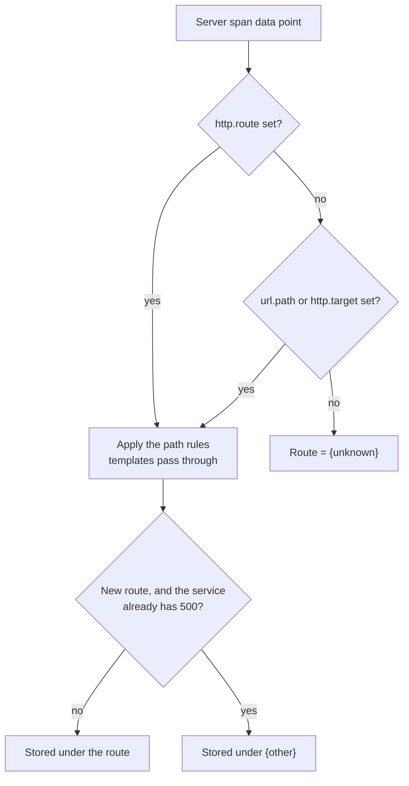

Lumenstat counts requests per route, such as `/accounts/{account}`, never per raw URL. It uses the `http.route` your framework sets when there is one. Otherwise it normalizes the raw path with a fixed set of rules that replace Stellar addresses, ids, hashes and tokens with placeholders. Values that match no rule are stored as they are, so `http.route` is the better source wherever you can set it.

## How it works

The writer resolves one route for every histogram point, in [`apps/writer/src/normalize.ts`](https://github.com/boundlessfi/lumenstat/blob/main/apps/writer/src/normalize.ts), then applies the per-service route cap in [`apps/writer/src/ingest.ts`](https://github.com/boundlessfi/lumenstat/blob/main/apps/writer/src/ingest.ts).



### Which attribute is used

| Order | Attribute | Typically set by |
| --- | --- | --- |
| 1 | `http.route` | Framework instrumentation, as a template such as `/accounts/:account` |
| 2 | `url.path` | HTTP server instrumentation, current semantic conventions |
| 3 | `http.target` | HTTP server instrumentation, older semantic conventions. Includes the query string |
| | none of them | The route is `{unknown}` |

The first attribute that holds a non-empty string wins. The path rules below run on it whichever it is. A template such as `/users/:id` or `/users/{id}` has no segment the rules match, so it passes through unchanged. A literal segment in a template is still checked: `/v2/2024/report` becomes `/v2/{id}/report`.

### Path cleanup

Before the segment rules run, the writer:

- keeps only the path of a full URL: `https://example.com/a/42?x=1` → `/a/{id}`;
- removes the query string and fragment: `/bounties/?page=2#top` → `/bounties`;
- collapses doubled slashes, removes a trailing slash and adds a leading one: `//api//v1/health/` → `/api/v1/health`;
- percent-decodes each segment before matching it: `/files/my%20report` → `/files/my report`.

The finished route is cut to 256 characters.

### Segment rules

Each segment between slashes is checked against these rules in order. The first match replaces the whole segment.

| Order | Segment | Becomes |
| --- | --- | --- |
| 1 | 56 characters starting with `G` that pass `StrKey.isValidEd25519PublicKey` | `{account}` |
| 2 | 56 characters starting with `C` that pass `StrKey.isValidContract` | `{contract}` |
| 3 | 69 characters starting with `M` that pass `StrKey.isValidMed25519PublicKey` | `{muxed}` |
| 4 | A UUID in 8-4-4-4-12 hex form, any version, either case | `{uuid}` |
| 5 | Digits only | `{id}` |
| 6 | Exactly 64 hex characters, such as a Stellar transaction hash | `{hash}` |
| 7 | `0x` followed by 8 or more hex characters | `{token}` |
| 8 | An opaque token: at least 20 characters from `A-Z a-z 0-9 _ - = . ~ +`, with at least one letter and one digit, and either both upper and lower case letters or digits making up at least 20% of its length | `{token}` |
| | Anything else | Unchanged |

`StrKey` is the address codec in `@stellar/stellar-sdk`. These examples are the output of `normalizePath` on real input:

```text
/accounts/GA5YQHLXHOEFNQA563Z3FOOMCXQJOVLLT62O2UOSJLLZI27YJEZKCWOL/payments  →  /accounts/{account}/payments
/contracts/CAILG6I6GWOAS3PGCFRGFYMA2BAWHT7GVBFT2FT4OLJMHQXGOJJ326R2/events     →  /contracts/{contract}/events
/pay/MCF4USQD4ND2G4SRDBXOPLBUXRBOAY4ULZ75JV5UI3XNQOMPMOAAOLFM2KUZ6RQFS7KZM     →  /pay/{muxed}
/users/3f2a9c1e-5b7d-4e8a-9c21-7d4e5f6a8b90                                   →  /users/{uuid}
/orders/12345/items/7                                                         →  /orders/{id}/items/{id}
/tx/b9d0b2292c4e09e8eb22d036171491e87b8d2086bf8b265874c8d182cb9c9020          →  /tx/{hash}
/wallets/0x52908400098527886E0F7030069857D2E4169EE7                           →  /wallets/{token}
/verify/eyJhbGciOiJIUzI1NiJ9.eyJzdWIiOiIxMjM0In0                              →  /verify/{token}
/commits/9fceb02d0ae598e95dc970b74767f19372d61af8                             →  /commits/{token}
/hackathons/web3-builders-hackathon-2026                                      →  /hackathons/web3-builders-hackathon-2026
/settings/notification-preferences                                            →  /settings/notification-preferences
```

The token rule keeps readable slugs. `web3-builders-hackathon-2026` is a single case and has fewer than 20% digits, so it stays.

### Why the checksum matters

A Stellar address is base32 text that encodes a version byte, the key or contract ID, and a two-byte CRC16 checksum. The version byte gives the first letter: `G` for an account, `C` for a contract, `M` for a muxed account. Lumenstat decodes the segment and verifies the checksum, so a string with the right first letter and length is not enough.

Change the last character of the account above and the result is kept as it is:

```text
/accounts/GA5YQHLXHOEFNQA563Z3FOOMCXQJOVLLT62O2UOSJLLZI27YJEZKCWOM  →  /accounts/GA5YQHLXHOEFNQA563Z3FOOMCXQJOVLLT62O2UOSJLLZI27YJEZKCWOM
```

A string that fails the checksum is never labeled `{account}`, `{contract}` or `{muxed}`. It can still become `{token}` under rule 8 if enough of its characters are digits. Otherwise it is stored unchanged.

## The 500-route cap

Each service can have at most 500 distinct routes. When the writer first sees a service after it starts, it loads the routes that service stored in the last 30 days. From then on a route it has not seen is admitted while the service has fewer than 500. After that, every new route is stored as `{other}`, with its counts and latency added to that row. Routes already admitted keep their names.

The cap is per service, so a second service in the same project has its own 500. Self-hosters can change the limit with the writer's `SCF_ROUTE_LIMIT` variable.

A large `{other}` row on the **API** page means a service is sending values the rules do not recognize. Set `http.route` for it.

## Why the rules are fixed

- **Cardinality.** Lumenstat stores one row per service, route, method, status code and minute. With raw paths, every account, order and transaction becomes its own route. Storage would grow with traffic instead of with the size of your API, and each route would hold a handful of requests, too few for a meaningful p95.
- **Privacy.** A Stellar account in a URL is a stable public identifier. Storing it per request would record which accounts called which endpoint, and when. A placeholder keeps the count and drops the identity. The same goes for UUIDs, numeric ids and tokens, and a JWT in a path is a credential.
- **Comparable numbers.** SCF operators compare usage across projects. `/accounts/{account}` means the same thing in every project because every project gets the same rules. The rule set is hard-coded on purpose. Projects that need finer control set `http.route` themselves.

## Set http.route yourself

Many server frameworks have an OpenTelemetry instrumentation that sets `http.route` from the matched route template, which is the best name a route can have. See [Node.js](/api/node) for Express and NestJS, and [Collector and other languages](/api/collector#use-sdk-environment-variables) for Java, Python, Go and Rust. On a server without a router, set `http.route` on the active server span in your handler.

## Limits

- **Values that match no rule are stored.** An email address, a username or a short id is kept as written: `/users/alice` and `/users/alice@example.com` stay unchanged, and so does `/files/invoice-12345.pdf`. If such values identify people, set `http.route`.
- **Rules see whole segments only.** An address inside a larger segment is not found. A Stellar asset written as `USDC:GA5YQHLXHOEFNQA563Z3FOOMCXQJOVLLT62O2UOSJLLZI27YJEZKCWOL` stays as it is, so each asset becomes its own route.
- **Lowercase addresses are not recognized.** StrKey encoding is upper case, so a lowercased account fails the check and is kept.
- **The cap does not judge.** If a service fills its 500 routes with unnormalized values, later legitimate routes land in `{other}` too.
- **Rules apply to `http.route` as well.** A template with a literal numeric or hex segment has that segment replaced.
