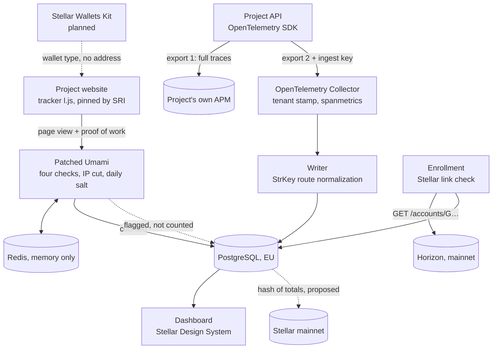

Lumenstat is one shared analytics service for Stellar ecosystem projects. Websites and APIs send usage through two ingest paths into one PostgreSQL database, and every project is measured by the same pipeline and the same bot rules. Stellar decides who can enroll, how API routes are grouped, and how wallet activity is counted without storing addresses.

This page is the technical architecture behind the SCF Build proposal for the RFP *Web and API Analytics for Stellar Ecosystem Projects*. It separates what runs today at [app.lumenstat.com](https://app.lumenstat.com) from what the [roadmap](/project/roadmap) plans.

## How it works

Both paths cut what arrives down to counts before anything is stored. The web path uses the visitor's IP in memory for a country lookup and a daily hash, then discards it. The API path keeps request counts, status codes and latency per route, and drops every span, trace and log. The dashboard and the metrics API read only what is stored.

| Part | What it does | Code |
| --- | --- | --- |
| Tracker `l.js` | Reports page views and custom events, computes the proof of work. Served at a versioned, immutable URL with a sha384 integrity hash | [`scripts/build-tracker.mjs`](https://github.com/boundlessfi/lumenstat/blob/main/scripts/build-tracker.mjs), [`packages/tracker`](https://github.com/boundlessfi/lumenstat/tree/main/packages/tracker) |
| Patched Umami v3.5.0 | Collect endpoint, the four bot and inflation checks, country lookup on the cut IP, counted and flagged event tables | [`patches/umami`](https://github.com/boundlessfi/lumenstat/tree/main/patches/umami) |
| Redis | The day's random salt and the per-network visitor counters, in memory only | [`deploy/compose.yaml`](https://github.com/boundlessfi/lumenstat/blob/main/deploy/compose.yaml) |
| OpenTelemetry Collector | Stamps the tenant from the ingest key, turns server spans into counts and latency histograms, drops spans, traces and logs | [`apps/collector/config.yaml`](https://github.com/boundlessfi/lumenstat/blob/main/apps/collector/config.yaml) |
| Writer | Normalizes routes, including Stellar addresses, and stores mergeable latency histograms. Serves the metrics API | [`apps/writer`](https://github.com/boundlessfi/lumenstat/tree/main/apps/writer) |
| PostgreSQL | One database for web events, flagged events and API metrics, every row tied to a project | [`deploy/compose.yaml`](https://github.com/boundlessfi/lumenstat/blob/main/deploy/compose.yaml) |
| Dashboard | Enrollment, project views and operator views, built with the Stellar Design System | [`apps/dashboard`](https://github.com/boundlessfi/lumenstat/tree/main/apps/dashboard) |
| Infrastructure as code | OpenTofu for Cloudflare, Ansible for the host, for staging and production | [`infra`](https://github.com/boundlessfi/lumenstat/tree/main/infra) |

[How it works](/how-it-works) follows a page view and an API request step by step.

## Stellar integration

Lumenstat deploys no contracts and holds no funds. Its Stellar work sits in four places: enrollment, API route normalization, wallet events and the dashboard. A fifth, anchoring daily totals on mainnet, is proposed.

### Enrollment with a Stellar link

A project enrolls itself at [app.lumenstat.com/signup](https://app.lumenstat.com/signup) with its domains and exactly one Stellar link. The link keeps the service for the ecosystem and gives operators a pointer to review.

| Link | What is checked |
| --- | --- |
| `G…` account | A valid StrKey with a matching CRC16-XModem checksum, then `GET https://horizon.stellar.org/accounts/<address>` on mainnet. A 404 refuses the link |
| `C…` contract | A valid StrKey with the contract version byte and checksum. Not looked up on chain |
| Page URL | An `https://` page on `communityfund.stellar.org`, `stellar.expert`, `stellarchain.io` or `lumenscan.io` |

Sign-up runs open, with operator approval, or closed, so SCF can move to approval-only enrollment without a code change. The checks live in [`apps/dashboard/src/lib/server/enrollment.ts`](https://github.com/boundlessfi/lumenstat/blob/main/apps/dashboard/src/lib/server/enrollment.ts). [Enrollment](/operators/enrollment) covers the flow and the review queue.

### Stellar-aware route normalization

API paths on Stellar services carry addresses and hashes. Stored as they are, every account would become its own route and the per-route numbers would mean nothing. The writer takes `http.route` when the framework sets it, otherwise the raw path, and rewrites each segment with fixed rules, using `StrKey` from `@stellar/stellar-sdk` 17.4.0:

| Segment | Check | Stored as |
| --- | --- | --- |
| 56 characters starting `G` | `StrKey.isValidEd25519PublicKey` | `{account}` |
| 56 characters starting `C` | `StrKey.isValidContract` | `{contract}` |
| 69 characters starting `M` | `StrKey.isValidMed25519PublicKey` | `{muxed}` |
| 64 hex characters, such as a transaction hash | Pattern | `{hash}` |
| Numeric id, UUID, `0x` hex, long random token | Pattern | `{id}`, `{uuid}`, `{token}` |

So `GET /accounts/GABC…/payments?cursor=…` from a wallet backend is stored as `/accounts/{account}/payments`, and `/transactions/<hash>` as `/transactions/{hash}`. The checksum check matters: a 56-character slug that only looks like an address is left alone.

The result is one row per route with p50, p95 and p99 latency, at most 500 routes per service, and no Stellar address stored from API traffic. See [`apps/writer/src/normalize.ts`](https://github.com/boundlessfi/lumenstat/blob/main/apps/writer/src/normalize.ts), its [tests](https://github.com/boundlessfi/lumenstat/blob/main/apps/writer/test/normalize.test.ts) and [Route normalization](/api/routes).

### Wallet activity without addresses

<Note>
  Planned for Milestone 1. Not built yet.
</Note>

An opt-in tracker module records a custom event when a visitor connects a wallet through [Stellar Wallets Kit](https://github.com/Creit-Tech/Stellar-Wallets-Kit). The event carries the wallet's id from the kit, such as `freighter` or `xbull`, and never the address. Projects see which wallets their users bring; SCF sees wallet connects counted the same way for every project.

It ships as tracker 1.1.0 at a new immutable URL with its own integrity hash. Version 1.0.0 does not change, so a project adopts the module by changing its snippet on purpose.

### A dashboard built with the Stellar Design System

The dashboard uses [`@stellar/design-system`](https://github.com/stellar/stellar-design-system) 4.0.2, with Inter and Inconsolata served from Lumenstat's own domain. Projects see Overview, Website, API, Setup and Settings. SCF operators see All projects, Compare, Traffic quality, Enrollment, and Keys and health.

### Proposed: daily totals anchored on Stellar

<Note>
  Proposed as an option in the SCF Build application. Not on the roadmap unless SCF asks for it.
</Note>

Once a day the service would hash each project's daily totals, combine the hashes into one root, and write the root to Stellar mainnet from a dedicated operator account. A script in the repository would recompute the root from published totals and compare it with the ledger. Anyone could then check that past usage numbers were never changed. It needs one transaction a day and no contract.

## Privacy, integrity and security

- **No personal data stored.** No cookies, no IP addresses, no API traces, logs or request bodies. A visitor hash lasts one day and its salt is deleted after 48 hours. See [Privacy](/trust/privacy).
- **Inflation is flagged, not counted.** Real-browser origin and Fetch Metadata, proof of JavaScript, about 8,900 data-center ranges and a per-network visitor limit. See [Bot and inflation defense](/trust/bot-defense).
- **The tracker is verifiable.** Immutable URLs, SRI, and a build that reproduces byte for byte in CI and on every deploy. See [Tracker supply chain](/trust/tracker-supply-chain).
- **Projects cannot see each other.** Website data is read with the member's own token; API data is written under the ingest key's tenant and read with scoped keys stored as SHA-256 hashes. See [Tenant isolation](/trust/tenant-isolation).
- **Vulnerabilities are reported privately.** See the [Security policy](/trust/security-policy) for how and how fast reports are handled.

## Where it runs

| | Today | Planned |
| --- | --- | --- |
| Servers | One Docker host in the EU (Germany), with CPU and memory limits per service | Ingest in two EU locations with an on-disk buffer and a rehearsed failover (Milestone 3) |
| Entry | No published ports. A Cloudflare Tunnel is the only way in. DNSSEC, TLS in Full (strict) mode | `t.` and `otlp.` served directly from EU servers, with no CDN (Milestone 2) |
| Data | PostgreSQL in the EU | Off-site EU backups with point-in-time recovery and a restore drill (Milestone 2) |
| Monitoring | Health checks on the operator Keys and health page | Alerts and a public status page with external probes (Milestone 2) |
| Operations | OpenTofu and Ansible for staging and production | Runbooks for deploy, Umami upgrade, restore, incident, key rotation and handover (Milestone 3) |

<Note>
  In the current pilot, `t.lumenstat.com` and `otlp.lumenstat.com` pass through Cloudflare, so Cloudflare sees visitor IP addresses in transit. Milestone 2 serves those two hostnames directly from EU servers. See [Cloudflare in the pilot](/trust/privacy#cloudflare-in-the-pilot).
</Note>

## Why Umami

The RFP lets proposers build on Umami or GoatCounter. Lumenstat uses Umami because it is MIT licensed, runs on PostgreSQL (the same database the API path needs), is written in TypeScript and Next.js, and supports ad-blocker-safe script and endpoint names out of the box. GoatCounter's license is a modified EUPL 1.2, and it is written in Go. Lumenstat's changes to Umami stay small patches, each behind its own switch, so every upstream release can be applied and reviewed as a diff.

## Limits

- **The Stellar link is a pointer, not proof of control.** The enrollment check proves the link's format and, for an account, that it exists on mainnet. It does not prove that the person signing up controls the account or contract.
- **Normalization sees whole path segments only.** An address inside a larger segment, such as an asset written `USDC:G…`, is kept as written, so each asset becomes its own route. See [Route normalization](/api/routes#limits).
- **One operator.** Lumenstat is a shared service with one accountable operator, so GDPR has a clear party and every project is measured the same way. The code and the infrastructure code are MIT, so another operator can rebuild it, and the [roadmap](/project/roadmap) includes runbooks and a handover.
