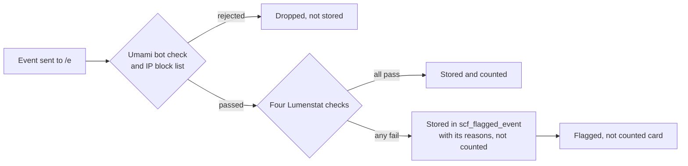

Every event sent for your website passes four checks before it is stored. An event that fails any of them is kept apart with its reasons and never counted. The **Flagged, not counted** card on the **Website** page shows how many such events your websites received in the selected range, and why. Your numbers already exclude them: the card exists so you can see attempts instead of absorbing them.

## How it works

1. **Real browser:** the `Origin` header is one of the website's domains or a subdomain of it, and Fetch Metadata headers are present.
2. **Proof of JavaScript:** the `x-lumenstat-pow` header holds a valid proof of work, computed by the tracker for this website, this page URL and the current 10-minute window.
3. **Data center:** the IP address is outside about 8,900 published cloud and hosting ranges.
4. **Many visitors per network:** the website has seen no more than 150 new visitors from the visitor's /24 or /48 network in the current hour.

The first three run on every event, and an event records every check it failed. The fourth runs only for events that passed the first three, so blocked scripts cannot push real visitors from the same network over the limit. [Bot and inflation defense](/trust/bot-defense) explains each layer in detail.

A flagged event keeps its path, referrer domain, country, browser, OS, device type and event name. It never keeps the IP address or the query string.

## Read the card

The title carries the total, for example **Flagged, not counted: 37**: the flagged events across all your project's websites in the selected range. Below it, each reason has its own row with a count, largest first. With nothing flagged, the card reads "Nothing flagged in this range".

- **Reason counts can add up to more than the total.** One event can fail several checks. A plain script that posts from a server usually fails at least two: "No browser origin" and "No proof of JavaScript".
- **Flagged events are in no other number.** Page views, visitors, bounce rate and custom events on the same page leave them out.
- **You see only your own.** The summary is read on the server and filtered to your project's websites before it reaches your browser. If it cannot be loaded, the card is hidden.

The dashboard shows each reason by name. The codes are the ones stored with the event and listed in [Flag reasons](/reference/flag-reasons).

| Card label | Code | Layer | Often caused by |
| --- | --- | --- | --- |
| No browser origin | `missing_origin` | 1. Real browser | A script or server posting without an `Origin` header. Also a page opened from a file or a sandboxed frame, which sends `Origin: null`. |
| Not a browser request | `not_browser_fetch` | 1. Real browser | No Fetch Metadata headers: a script, a browser too old to send them, or a page not served over HTTPS. |
| Site has no domain | `no_site_domain` | 1. Real browser | The website has no domain recorded. A setup problem, not an attack: tell an SCF operator. |
| Sent from another domain | `origin_mismatch` | 1. Real browser | Your tracker running on a host that is not your website's domain or a subdomain of it: a preview deploy, `localhost`, a staging site, a copy of your site. |
| No proof of JavaScript | `no_proof` | 2. Proof of JavaScript | A script that forged browser headers but did not run the tracker. Also a page running a tracker without the proof, such as upstream Umami's script. |
| Invalid proof of JavaScript | `bad_proof` | 2. Proof of JavaScript | A proof made for another page, website or 10-minute window. A device clock more than about 10 minutes off can cause it, and 20 minutes or more always does. |
| Data-center IP | `datacenter_ip` | 3. Data center | Automation on a cloud or hosting server. Also real visitors behind a VPN or proxy that runs in one of those ranges. |
| Too many visitors from one network | `many_visitors_per_network` | 4. Many visitors per network | A burst of new visitors from one network: many clients behind one subnet, or a real crowd on shared Wi-Fi, a campus or a mobile carrier. Visitors already counted that hour keep counting. |

### Common patterns

- **Mostly "Sent from another domain".** Almost always your own tracker on a host you did not enroll. Set `data-domains` so previews and local builds send nothing ([Framework recipes](/web/frameworks)), or ask an SCF operator to add the domain.
- **"No browser origin" together with "No proof of JavaScript".** Plain scripted posts from a server.
- **"No proof of JavaScript" alone.** A script that forged `Origin` and Fetch Metadata to look like a browser, but never ran the tracker.
- **A small, steady share of "Data-center IP" and "Invalid proof of JavaScript".** Background traffic from automation, VPN users and devices with wrong clocks. Expect some on any public site.
- **"Too many visitors from one network" during an event you ran.** Likely real people sharing one network. Only new visitors beyond the limit in that hour are flagged.

## Why someone would inflate your numbers

SCF compares projects' usage with the same pipeline and the same rules, and those numbers inform its decisions. That gives people reasons to send fake traffic:

- **To make a project look more used than it is.**
- **To make a project look as if it were faking its own numbers.**
- **For no reason related to you.** Spam bots and scanners post to any analytics endpoint they find.

Anyone can try. Your website id is in the HTML of every page you serve, and the collect endpoint is public. A flagged event shows that something failed a check. It does not show who sent it.

You can test the defense on your own website: [Quickstart](/quickstart#see-the-bot-defense-work) shows how to send scripted page views with `scripts/fake-event.mjs` and watch them land in this card instead of your totals.

## What you can do

- **Fix what is yours.** Serve every page over HTTPS, use the pinned Lumenstat tracker, set `data-domains`, and make sure every domain you track belongs to the project.
- **Nothing else is needed to protect your numbers.** Flagged events are already excluded.
- **Tell an SCF operator if the volume looks deliberate.** Operators see the latest flagged events for each website on [Traffic quality](/operators/traffic-quality), with time, path, reasons, referrer domain, country and client.

## Limits

- **Requests rejected before the checks are not shown.** Umami's own bot check, by user agent, and its IP block list drop requests before the four layers run. Those are not stored and do not appear in the card.
- **Projects see counts, not events.** The card shows totals by reason. The individual events, with their paths and times, are visible to SCF operators only.
- **Some real visitors are flagged.** VPN and proxy users in data-center ranges, crowds beyond the per-network limit, devices with wrong clocks and browsers without Fetch Metadata.
- **Passing every check is not proof of a human.** A real browser that runs the tracker from a home or mobile network passes all four layers. The checks raise the cost of faking traffic. They do not make it impossible.
