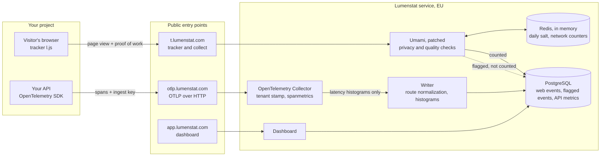
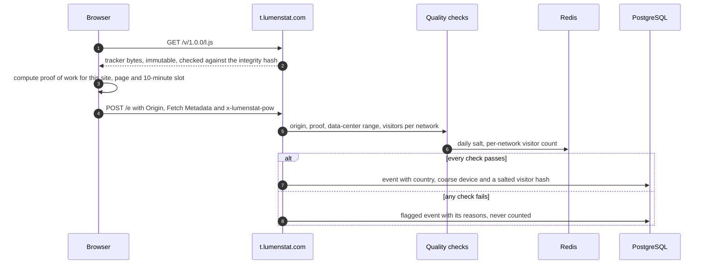

Lumenstat has two ways in. Websites send page views and custom events from a small script to the collect endpoint. APIs send OpenTelemetry data from a second exporter to the collector. Both paths reduce what arrives to the minimum needed for usage numbers, then store it in one PostgreSQL database that the dashboard reads for projects and for SCF operators.

The servers publish no ports. A Cloudflare Tunnel opened from inside the stack is the only way in, and it routes only the tracker files, the collect endpoint, the OTLP endpoints and the dashboard. Umami's own admin interface and API are not reachable from the internet.

## A page view, step by step

1. **The script is pinned.** The browser loads a versioned file and refuses it if its bytes do not match the integrity hash in your snippet. See [Tracker supply chain](/trust/tracker-supply-chain).
2. **The tracker proves it ran.** It computes a small proof of work bound to the site, the page URL and the current 10-minute window, and sends it as a header. A script that posts events without running the tracker cannot produce it.
3. **The checks run before anything is stored.** Origin and Fetch Metadata, the proof, the data-center ranges and the per-network visitor limit. See [Bot and inflation defense](/trust/bot-defense).
4. **The IP address never reaches the database.** It is cut to its /24 or /48 network for a country lookup, hashed with the user agent and the day's random salt into a visitor id, and then discarded. Region and city are never derived. See [Privacy](/trust/privacy).
5. **Failures are kept apart.** A flagged event is stored in its own table with its reasons, so a project and the SCF operators can see that someone tried to inflate the numbers, and by how much.

## An API request, step by step

Your service keeps exporting full traces to whatever APM you use today. A second exporter sends the same spans to Lumenstat with your ingest key.

1. **The collector stamps the tenant.** It deletes any tenant attribute the client sent, then copies the ingest key from the request header onto the data. Spans from different projects are never merged.
2. **Spans become numbers.** The collector's spanmetrics connector turns server spans into request counts and latency histograms per route, method and status code. Then every span, trace and log is dropped.
3. **Routes are normalized.** The writer uses `http.route` when your framework sets it. Otherwise it rewrites the raw path: checksum-valid Stellar addresses become `{account}`, `{contract}` or `{muxed}`, and ids, hashes and tokens become placeholders. See [Route normalization](/api/routes).
4. **Latency is stored as mergeable histograms.** Counts on fixed millisecond buckets let p50, p95 and p99 be computed across instances and any time range.

See [API analytics](/api/overview) to set it up.

## Who sees what

| Viewer | Sees | How access is enforced |
| --- | --- | --- |
| Project member | Their project's website and API numbers, and its flagged traffic | Website data is read with the member's own Umami token. API data is filtered on the server to the tenant linked to the project |
| SCF operator | Every project, side by side, plus traffic quality and enrollment | Operators are Umami administrators |
| The public | Nothing | No public dashboards today |

[Tenant isolation](/trust/tenant-isolation) explains each boundary and how it was tested.

## Where it runs

One Docker host in the European Union (Germany) runs PostgreSQL, Redis, the patched Umami, the collector, the writer and the dashboard, each with CPU and memory limits. DNS is signed with DNSSEC, and Cloudflare's TLS mode is Full (strict). The whole setup is described as code with OpenTofu and Ansible, for staging and production. See [Self-hosting](/self-hosting/overview).

<Note>
  In the current pilot, `t.lumenstat.com` and `otlp.lumenstat.com` pass through Cloudflare, so Cloudflare sees visitor IP addresses in transit. The production design serves those two hostnames directly from EU servers, so no CDN sees them. See [Cloudflare in the pilot](/trust/privacy#cloudflare-in-the-pilot) and the [roadmap](/project/roadmap).
</Note>
