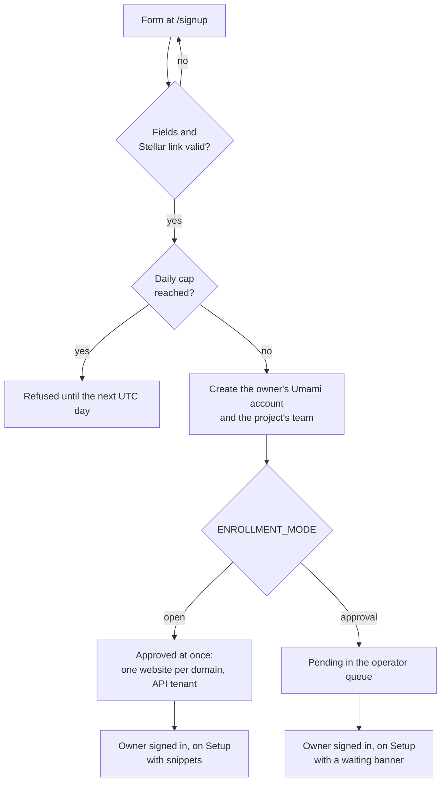

Projects enroll themselves at [app.lumenstat.com/signup](https://app.lumenstat.com/signup). Sign-up creates the owner's account and the project at once, and the enrollment mode decides whether tracking starts immediately or after an operator approves it. The Stellar link ties a project to the ecosystem for review. It does not prove that the person signing up controls it.

## The sign-up flow

In `closed` mode the form is not shown. If creating the team or recording the sign-up fails after the account was created, the account and team are deleted again, so the person can retry with the same email.

## The form

| Field | Rules |
| --- | --- |
| Project name | 2 to 50 characters. Repeated spaces are collapsed. |
| Website domains | One per line or comma-separated, up to 5. Each is cleaned the way people paste it: the scheme, path, query, port, trailing dot and a leading `www.` are removed, so `https://www.example.org/app` becomes `example.org`. Duplicates are dropped. IP addresses, `localhost` and names ending in `.local`, `.test`, `.example`, `.invalid` or `.internal` are refused. |
| Stellar link | A `G…` account, a `C…` contract, or a page on an accepted site. See [The Stellar link check](#the-stellar-link-check). |
| Your email | Becomes the owner's sign-in name. If an account with that email exists, sign-up is refused and the person is told to sign in. |
| Password | 12 to 128 characters. |

Subdomains need no entry of their own: the collect endpoint accepts events from a domain and every subdomain of it.

Sign-up also has three limits against abuse:

- **A hidden field.** People never see it. A submission that fills it in is refused.
- **Five attempts per IP address per hour.** Counted in the dashboard's memory, in addition to a rate limit at the edge on `POST /signup`.
- **A daily cap** on sign-ups, described under [Modes](#modes).

## The Stellar link check

The form accepts exactly one link, in one of three forms:

| Input | What is checked |
| --- | --- |
| `G…` account | A valid StrKey: 56 base32 characters that decode to the account version byte, a 32-byte key and a matching CRC16-XModem checksum. Then `GET https://horizon.stellar.org/accounts/<address>` on mainnet, with a 4-second timeout. A 404 refuses the link: "That account does not exist on Stellar mainnet." Any other outcome, including no answer within the timeout, accepts the well-formed address. |
| `C…` contract | A valid StrKey with the contract version byte and a matching checksum. It is not looked up on chain. |
| Page URL | An `https://` URL on `communityfund.stellar.org`, `stellar.expert`, `stellarchain.io` or `lumenscan.io`, or a subdomain of one. A leading `www.` is ignored. The page is not fetched. |

Muxed (`M…`) addresses, other key types, `http://` links and other hosts are refused.

<Warning>
  The check proves the format of the link and, for an account, that it exists on mainnet. It does not prove that the person signing up controls the account or contract, or that the page describes their project. Any public address passes. Treat the link as a pointer for your review.
</Warning>

## Modes

The mode is set with `ENROLLMENT_MODE` in the dashboard's environment. The banner at the top of **Enrollment** shows the mode in effect.

| Mode | What happens on sign-up | What the project sees |
| --- | --- | --- |
| `open` | Approved at once: one Umami website per domain and an API tenant are created, and the decision is recorded as made by "open enrollment". This is the default when the variable is unset or has any other value. | **Setup** with a snippet for each domain. |
| `approval` | Recorded as pending. Nothing is tracked until an operator approves it. | A banner on every page saying the sign-up is waiting for an SCF operator, and no snippet on **Setup**. |
| `closed` | The form is off. `/signup` says sign-up is closed and points to sign-in. | Nothing new. Existing projects are unaffected. |

**Daily cap.** `ENROLLMENT_DAILY_LIMIT` sets how many sign-ups are accepted per UTC day, 25 by default. Every sign-up recorded that day counts, whatever its status. Once the cap is reached, the form refuses new sign-ups until the next UTC day.

## Review the queue

**Enrollment** has three parts:

- **Waiting for approval**, with a count. Each pending sign-up shows the project name, the contact email, the date, the domains and the Stellar link. Account and contract addresses open on stellar.expert. URLs open as given.
- **Enrolled projects:** every project with its domains, **Added by** ("Sign-up" or "Operator") and the date it was created.
- **Recent decisions:** the latest 50, with project, contact, decision, who decided and when.

If the queue cannot be loaded, a banner says the writer is unreachable. The rest of the page still shows enrolled projects.

<Steps>
  <Step title="Check the sign-up">
    Open the Stellar link and confirm it describes this project. Open each domain and confirm it is the project's site. Look under **Enrolled projects** for the same project enrolled twice.
  </Step>

  <Step title="Approve it">
    Select **Approve**. Lumenstat creates one Umami website per domain, skipping any domain that already has one, creates the project's API tenant, and records the approval with your username. The waiting banner disappears from the project's pages and its snippets appear on **Setup**.
  </Step>

  <Step title="Or reject it, with a reason">
    Type a reason in the field next to **Reject**, then select **Reject**. The reason is optional and limited to 300 characters. It is shown to the project on every page: "This sign-up was not approved: *your reason*". No website and no API tenant are created.
  </Step>
</Steps>

A decision is recorded once. A sign-up that was approved or rejected cannot be changed from the dashboard.

## Limits

- **The Stellar link is not proof of ownership.** See the warning above. In `open` mode, nobody reviews it before tracking starts.
- **A rejected sign-up keeps its account.** The owner can still sign in and sees an empty project with the rejection banner. Suspending and removing projects is planned for Milestone 2.
- **The per-IP limit lives in memory.** It resets when the dashboard restarts and is not shared between instances.
- **Domains after sign-up are added by an operator.** Projects cannot add a domain themselves yet.

{/* TODO: document how an operator adds a domain to an existing project. The Settings page says "An SCF operator adds domains", but the dashboard has no screen for it. */}
