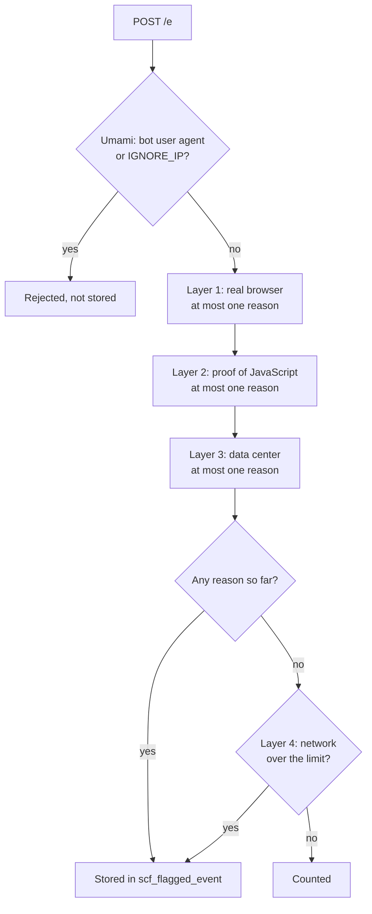

When an event fails a quality check, the collect endpoint stores it in `scf_flagged_event` with one or more reasons and does not count it. This page lists each reason with its exact trigger in the source, the real traffic that can trip it, and what to do. Some real visitors are flagged by design: the checks trade a small loss of real traffic for numbers that are hard to inflate.

Source: `quality.ts`, `origin.ts`, `pow.ts`, `datacenter.ts` and `fingerprints.ts` in `vendor/umami/src/lib/scf`, which `scripts/sync-umami.sh` builds from Umami v3.5.0 and the patches. Layer 1 comes from [patch 0003](https://github.com/boundlessfi/lumenstat/blob/main/patches/umami/0003-scf-count-only-browser-events-from-a-site-s-own-doma.patch), the flag and layers 2 to 4 from [patch 0004](https://github.com/boundlessfi/lumenstat/blob/main/patches/umami/0004-scf-flag-suspect-traffic-instead-of-counting-it-bot-.patch).

| Reason | Layer | Flagged when |
| --- | --- | --- |
| `missing_origin` | 1. Real browser | No usable `Origin` header |
| `not_browser_fetch` | 1. Real browser | `Origin` present, Fetch Metadata missing |
| `no_site_domain` | 1. Real browser | The website has no domain set |
| `origin_mismatch` | 1. Real browser | `Origin` is not one of the site's domains |
| `no_proof` | 2. Proof of JavaScript | No `x-lumenstat-pow` header |
| `bad_proof` | 2. Proof of JavaScript | The proof is malformed, stale or too weak |
| `datacenter_ip` | 3. Data center | The IP is in a listed cloud or hosting range |
| `many_visitors_per_network` | 4. Many visitors per network | The visitor's network passed the hourly limit for the site |

## How reasons combine

- **Umami's own checks run first.** A user agent that `isbot` recognizes gets `{"beep": "boop"}` and nothing is stored. An IP listed in Umami's `IGNORE_IP` gets HTTP 403. Neither is a flag reason.
- **Layers 1 to 3 each add at most one reason.** Within layer 1 the checks run in table order and the first failure is the reason. An event can carry up to three reasons, one per layer.
- **Layer 4 runs only on clean events.** A visitor is counted toward its network's limit only after passing layers 1 to 3, so blocked scripts cannot push real visitors over the limit. `many_visitors_per_network` therefore never appears with another reason.
- **Which events.** Page views, custom events, `identify` calls and performance events with a website id are checked. Error reports from `data-errors` are handled before the checks and never flagged.
- **Same reply.** A flagged event gets `{"beep": "boop"}`, the reply bots get. It does not say which check failed.
- **Each layer has its own switch.** With none set, the fork behaves like upstream Umami. The switches are listed under each layer below and on [Configuration](/self-hosting/configuration#quality-checks).

### What is stored

A flagged row keeps the website id, the time, the reasons, the event type and name, the hostname, the URL path without its query string, the referrer domain, the country, and the browser, OS and device type. It never keeps the IP address or the query string. Each flagged event is also logged as one JSON line from the `umami` service: `{"scf":"event_flagged","websiteId":"…","reasons":["…"]}`.

The event type is "custom event" when the event has a name and "page view" otherwise, so flagged `identify` and performance events are recorded as page views.

There is no way to move a flagged event into the counted totals later. Fixing the cause affects new events only.

Project members see flagged counts per reason under **Flagged, not counted** on the **Website** screen ([Flagged traffic](/dashboard/flagged-traffic)). SCF operators see them for every project under [Traffic quality](/operators/traffic-quality).

## Layer 1: real browser

**Switch:** `SCF_ENFORCE_ORIGIN`. Any non-empty value turns it on. The hosted service sets `"1"`.

Browsers attach `Origin` and the Fetch Metadata headers `Sec-Fetch-Mode` and `Sec-Fetch-Site` to the tracker's request. A script posting from a server usually does not.

Domains are compared after normalizing both sides: lowercase, then scheme, path, port, a trailing dot and a leading `www.` removed. The `Origin` host passes when it equals a site domain or is a subdomain of one. A site's domain field can list several domains separated by commas.

### `missing_origin`

**Trigger.** The request has no `Origin` header, the header is the literal string `null`, or its value is not a parseable URL.

**Common legitimate causes**

- A page opened from a `file://` URL, or running in a sandboxed iframe. Browsers send `Origin: null` from both.
- Your own server-side or test code posting to `/e` without a browser.

**What to do.** Load the tracker from a page served on one of the site's domains. Server-side page views are not supported: the collect endpoint counts events sent by a browser only.

### `not_browser_fetch`

**Trigger.** `Origin` is present, but `Sec-Fetch-Mode` or `Sec-Fetch-Site` is missing.

**Common legitimate causes**

- A site served over plain HTTP. Browsers send Fetch Metadata only in secure contexts, so Lumenstat requires HTTPS.
- A self-hosted collect endpoint served over plain HTTP.
- A browser too old to send Fetch Metadata.

{/* TODO: confirm the plain-HTTP site case. The Fetch Metadata spec decides on the request URL, which would mean a page on plain HTTP posting to https://t.lumenstat.com still sends the headers and only the collect endpoint's scheme matters. README and AGENTS.md say the site must use HTTPS. Test with a real browser before changing this text. */}

**What to do.** Serve the site over HTTPS. If a self-hosted collect endpoint is on HTTP, put it behind TLS. If the flagged rows cluster on one browser or OS, that browser is likely too old to send the headers.

### `no_site_domain`

**Trigger.** `Origin` and Fetch Metadata are present, but the website's domain field is empty.

**Common legitimate causes**

- A website created without a domain, for example by hand in Umami's admin UI. Enrollment always sets one domain per website.

**What to do.** On the hosted service, ask an SCF operator to set the domain. On your own instance, set the website's domain in Umami. Every event for the site is flagged until then.

### `origin_mismatch`

**Trigger.** The `Origin` host is neither one of the site's domains nor a subdomain of one.

**Common legitimate causes**

- The site moved to a new domain, or is also served on a domain that was never registered.
- Preview or staging deployments on another domain, for example a hosting provider's preview URL.
- Local development on `localhost` with the production snippet.

**What to do.** Register every domain the site is served from. Subdomains of a registered domain already pass, so registering `example.org` covers `docs.example.org`. To keep previews and `localhost` from sending at all, set [`data-domains`](/reference/tracker-attributes#core) in the snippet.

## Layer 2: proof of JavaScript

**Switch:** `SCF_POW_BITS`, an integer from 1 to 24: the number of leading zero bits the proof must have. Unset, `0` or any other value turns the check off. The hosted service sets `"10"`.

The tracker sends `x-lumenstat-pow: <slot>.<nonce>`, where `sha256("<website>:<slot>:<url>:<nonce>")` starts with at least 10 zero bits and `slot` is the 10-minute window. The [tracker reference](/reference/tracker-attributes#the-collect-request) has the exact format.

### `no_proof`

**Trigger.** The `x-lumenstat-pow` header is missing.

**Common legitimate causes**

- The page loads a tracker built without the proof of work, such as upstream Umami's `script.js` or a copy from another Umami install, pointed at Lumenstat with `data-host-url`.
- On an instance that moved from upstream Umami to this fork: browsers still running upstream's `/script.js` from their cache. Umami serves `/script.js` with a one-day cache.
- Custom code that posts to `/e` directly instead of using the tracker.

**What to do.** Load a released tracker from `/v/<version>/l.js` (see [Tracker releases](/reference/tracker-releases)), or call `umami.track` from it instead of posting yourself. After moving an instance from upstream Umami, expect cached old trackers to clear within a day.

### `bad_proof`

**Trigger.** One of:

- the header is not `<slot>.<nonce>` with a slot of 1 to 10 digits and a nonce of 1 to 12 digits;
- the slot is more than one 10-minute window away from the server's current window;
- the hash of `<website>:<slot>:<url>:<nonce>`, using the `website` and `url` in the payload, has fewer leading zero bits than `SCF_POW_BITS`.

**Common legitimate causes**

- A device clock that is wrong. A clock off by less than 10 minutes always passes. Off by 20 minutes or more always fails. In between, it depends on where in the window the event falls.
- A proxy or extension that rewrites the request body after the tracker computed the proof.
- On a self-hosted instance, `SCF_POW_BITS` set above 10. The tracker always works to 10 bits, so most real visitors fail.

**What to do.** If the flagged rows come from a handful of visitors, it is their clocks and nothing needs to change. If every visitor is flagged on a self-hosted instance, check `SCF_POW_BITS` and the server's clock.

<Warning>
  The proof of work raises the cost of faking events. It does not prove a human. A script that reimplements it passes this layer, as `scripts/fake-event.mjs --level proof` shows.
</Warning>

## Layer 3: data center

**Switch:** `SCF_DATACENTER_RANGES`, the path to a file with one CIDR range per line (`#` starts a comment). Unset turns the check off. The hosted service mounts [`deploy/datacenter-ranges.txt`](https://github.com/boundlessfi/lumenstat/blob/main/deploy/datacenter-ranges.txt) at `/etc/lumenstat/datacenter-ranges.txt`.

The file holds about 8,900 ranges from the providers' own published lists and from the prefixes announced by hosting-only networks: AWS, Google Cloud, Oracle Cloud, DigitalOcean, Akamai (Linode), Hetzner, OVHcloud, Contabo, Vultr, Scaleway, Alibaba Cloud and Tencent Cloud. `node scripts/update-datacenter-ranges.mjs` rebuilds it. The IP is checked in memory and never stored.

### `datacenter_ip`

**Trigger.** The visitor's IP address falls inside a range in the file.

**Common legitimate causes**

- A VPN, proxy or privacy service whose servers run on one of the listed providers.
- A corporate gateway or cloud-hosted browser running on one of those networks.
- Your own uptime checks or end-to-end tests that drive a real browser from a cloud machine.

**What to do.** For visitors, nothing: this is the layer's intended trade-off, and there is no per-site allow list. Point automated browser tests at a separate website id so they do not mix with real traffic. On a self-hosted instance you can edit the file. Umami reads it once per path and keeps it in memory, so restart the `umami` service after changing it. If the file cannot be read, Umami logs `datacenter_ranges_unreadable` and the check flags nothing.

## Layer 4: many visitors per network

**Switch:** `SCF_MAX_VISITORS_PER_IP_HOUR`, a positive integer: the number of distinct visitors allowed per site, per network, per hour. Unset or not a positive integer turns the check off. It also needs Redis (`REDIS_URL`). The hosted service sets `"150"`, a generous value because mobile carriers put many people behind one IPv4 network.

A visitor is an IP address plus a user agent. A network is the IP cut to /24 for IPv4 or /48 for IPv6. Visitors are counted in a Redis HyperLogLog per site, network and UTC clock hour. Keys and members are HMACs under the random daily salt (or the app secret when that salt is off), so Redis never holds an IP or a network address. Keys expire after two hours.

### `many_visitors_per_network`

**Trigger.** The event passed layers 1 to 3, its visitor is new for this site, network and hour, and adding it takes the count above the limit. Visitors already counted that hour keep counting. The count starts over at the next full hour.

**Common legitimate causes**

- A company, university or government network where many people share one address range.
- Conference or event Wi-Fi during a talk or launch that links to the site.
- A mobile carrier that puts many subscribers behind a few addresses.

**What to do.** On the hosted service the limit is the same for every site, and there is no per-site override. If your audience sits on a few large networks, tell the SCF operators so they can read your flagged traffic in that light. On a self-hosted instance, raise `SCF_MAX_VISITORS_PER_IP_HOUR`. If every visitor lands on the same network, Umami is reading the IP of a proxy: check `CLIENT_IP_HEADER` on [Configuration](/self-hosting/configuration#umami).

Counting is best effort: if Redis fails, the event is not flagged.

## Limits

- No layer proves a human. A script that runs a real browser on a home connection, loaded from the site's own domain, passes all four. Read [Bot and inflation defense](/trust/bot-defense) for what each layer does not stop.
- Real visitors can be flagged, as listed above. The share of flagged traffic per reason is the signal to read, not single events.
