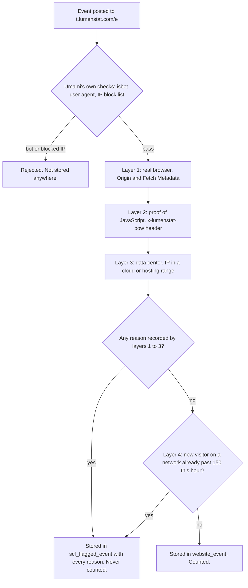

Lumenstat's numbers help decide which Stellar projects are really used, so someone will try to inflate them. Every event sent to the collect endpoint passes four checks, and an event that fails any of them is stored in `scf_flagged_event` with its reasons instead of being counted. No single check proves a human is behind a visit. Together they make fake traffic cost far more than a script in a loop.

## How it works



- **Umami's checks run first.** Its `isbot` test on the user agent and its IP block list still apply. Requests they reject are not stored anywhere, so they do not appear in `scf_flagged_event`.
- **Layers 1 to 3 always all run.** A flagged event records every reason that applies, so one event can carry `missing_origin`, `no_proof` and `datacenter_ip` at once.
- **Layer 4 runs last, and only on clean events.** It counts a visitor only if layers 1 to 3 found nothing. See [why](#why-only-events-that-passed-layers-1-to-3).
- **Flagged events get the same reply as bots**, `{"beep":"boop"}`, so a script cannot tell which layer stopped it.
- **Page views, custom events, `identify` calls and performance events** all go through the checks. Error reports do not: see [Limits](#limits).

Each layer has its own switch. With none set, the fork behaves like upstream Umami. These are the production values, from [`deploy/compose.yaml`](https://github.com/boundlessfi/lumenstat/blob/main/deploy/compose.yaml):

| Layer | Switch | Production value | Reasons |
| --- | --- | --- | --- |
| 1. Real browser | `SCF_ENFORCE_ORIGIN` | `1` | `missing_origin`, `not_browser_fetch`, `no_site_domain`, `origin_mismatch` |
| 2. Proof of JavaScript | `SCF_POW_BITS` | `10` | `no_proof`, `bad_proof` |
| 3. Data center | `SCF_DATACENTER_RANGES` | path to `datacenter-ranges.txt` | `datacenter_ip` |
| 4. Many visitors per network | `SCF_MAX_VISITORS_PER_IP_HOUR` | `150` | `many_visitors_per_network` |

The code lives in `src/lib/scf/` of the patched Umami (`quality.ts`, `origin.ts`, `pow.ts`, `datacenter.ts`, `fingerprints.ts`) and in `src/tracker/pow.ts`, added by [patches 0003 and 0004](https://github.com/boundlessfi/lumenstat/tree/main/patches/umami). Every reason is listed in the [flag reasons reference](/reference/flag-reasons).

## Layer 1: real browser

**Signal.** The `Origin`, `Sec-Fetch-Mode` and `Sec-Fetch-Site` request headers.

**Check.** In this order, stopping at the first failure:

1. `Origin` is missing, is `null`, or is not a valid URL → `missing_origin`.
2. `Sec-Fetch-Mode` or `Sec-Fetch-Site` is missing → `not_browser_fetch`. Only their presence is checked, not their values.
3. The site has no domain set → `no_site_domain`.
4. The `Origin` host is not one of the site's domains or a subdomain of one → `origin_mismatch`.

A site's domain field may list several domains, separated by commas. Both sides are normalized first: lowercased, with the scheme, port, path, trailing dot and a leading `www.` removed. `docs.example.org` matches `example.org`. Look-alikes such as `example.org.evil.com` and `notexample.org` do not.

**Why it works.** Browsers set `Origin` and the `Sec-Fetch-*` headers themselves, and page JavaScript cannot set or change them. A page on another domain that copies your website id sends its own origin, not yours.

**Stops:**

- Your website id pasted into someone else's site.
- Plain server-side posts, such as `curl` or a `fetch` from Node or Python, which send no `Origin` or no Fetch Metadata.
- Pages with an opaque origin, such as sandboxed iframes and `file://` pages.

**Does not stop:**

- Any non-browser client can write these headers by hand. The `forged` test level does exactly that. On its own, layer 1 is a speed bump.
- A real or headless browser loading your actual site sends real headers.
- Every subdomain of a listed domain passes, including subdomains that serve content you do not control.

**Can flag real visitors.** Browsers send Fetch Metadata only in secure contexts, so every event from a site served over plain HTTP is flagged `not_browser_fetch`. Sites must use HTTPS. Browsers too old to send Fetch Metadata are flagged the same way.

## Layer 2: proof of JavaScript

**Signal.** The `x-lumenstat-pow` header, in the form `<slot>.<nonce>`.

The tracker computes it before each send:

```text
slot   = floor(time in ms / 600000)              the current 10-minute window
input  = "<website id>:<slot>:<url>:<nonce>"     url exactly as in the event payload
nonce  = the first of 0, 1, 2, ... for which SHA-256(input) starts with 10 zero bits
header = x-lumenstat-pow: <slot>.<nonce>
```

The URL is the full page URL the tracker puts in the payload, query string and fragment included, before the server strips the query. The tracker carries its own small synchronous SHA-256, tested against `node:crypto`, so it needs no dependency and avoids WebCrypto's per-call async overhead. The result is cached per page and window, so further events on the same page cost nothing.

**Check.**

1. No header → `no_proof`.
2. The header is not 1 to 10 digits, a dot, then 1 to 12 digits → `bad_proof`.
3. The slot is more than one window away from the server's current slot → `bad_proof`.
4. The server recomputes SHA-256 from the event's own website id and URL with the header's slot and nonce. Fewer than `SCF_POW_BITS` leading zero bits → `bad_proof`.

### Why 10 bits

Each nonce has a 1 in 2<sup>10</sup> chance of producing 10 leading zero bits, so the tracker tries about 1,024 hashes on average. That takes a few milliseconds on a phone, once per page per window, and the visitor never notices.

The point is not to make each event expensive. A native SHA-256 implementation does 1,024 hashes for almost nothing. What a valid proof shows is that the client ran the tracker's logic, or that someone reverse-engineered it on purpose. Generic bots, header-only forgeries and requests replayed from another page or site all fail.

The server accepts values from 1 to 24 bits, but tracker 1.0.0 stops at the first nonce with at least 10 zero bits. Half of those nonces have exactly 10, so setting `SCF_POW_BITS` to 11 would flag about half of real visits. A harder proof needs a new tracker version, which means a new URL and hash in every snippet. See [Tracker supply chain](/trust/tracker-supply-chain).

### 10-minute slots

The slot comes from the visitor's clock, cut into 10-minute windows. The server accepts its current window and the one on either side.

- **Validity.** When clocks agree, a proof stays valid for more than 10 and at most 20 minutes after the tracker made it. That covers slow networks and delayed requests. A captured proof stops working soon after.
- **Clock skew.** A device clock off by less than 10 minutes always passes. Off by 20 minutes or more, it always fails with `bad_proof`. In between, it depends on where the window boundaries fall.

### What the hash binds

| Input | Why it is in the hash |
| --- | --- |
| Website id | A proof made for one site does not verify on another. |
| Slot | A proof expires within 20 minutes. Proofs captured from real visits cannot be saved up and replayed later. |
| URL | A proof made for one page, or one query string, does not verify for another. |
| Nonce | The work. It is the only part the client chooses. |

The header carries only the slot and the nonce. The server takes the website id and the URL from the event itself and recomputes the digest, so a proof cannot move to an event for another site or another page.

<Warning>
**Replay on the same page is not blocked.** Nothing records which proofs were already used, so one valid header can be sent with any number of events for the same site and URL until its window closes. Layer 2 costs an attacker one proof per page per 10 minutes, not one per event. Layers 3 and 4 limit the rest.
</Warning>

**Stops:**

- Scripts that neither run nor reimplement the tracker.
- Requests with forged browser headers and no proof.
- Proofs lifted from another site, another page or an earlier window.

**Does not stop:**

- Anyone who reimplements the proof. `scripts/fake-event.mjs` does it in a few lines.
- Headless browsers that run the real tracker.
- Replays on the same page within a window.

## Layer 3: data center

**Signal.** The client IP address. In production, Umami reads it from `cf-connecting-ip`, which Cloudflare sets. The origin is reachable only through the tunnel, so a client cannot supply its own value. An `ip` field in the payload is ignored.

**Check.** The full address, not truncated, is looked up by binary search in the merged, sorted list of ranges held in memory. IPv4-mapped IPv6 addresses are converted to IPv4 first. A match → `datacenter_ip`. The address is checked in memory only and never stored.

### The list

[`deploy/datacenter-ranges.txt`](https://github.com/boundlessfi/lumenstat/blob/main/deploy/datacenter-ranges.txt) holds about 8,900 merged CIDR ranges at its last rebuild, on 13 November 2026. Providers that publish a list are read from it. For hosting networks that publish none, the prefixes their autonomous systems announce come from RIPEstat.

| Provider | Source |
| --- | --- |
| Amazon Web Services | Published `ip-ranges.json` |
| Google Cloud | Published `cloud.json` |
| Oracle Cloud | Published `public_ip_ranges.json` |
| DigitalOcean | Published geo feed, and prefixes announced by AS14061 |
| Akamai Connected Cloud (Linode) | Published geo feed, and prefixes announced by AS63949 |
| Hetzner | AS24940, and AS213230 for Hetzner Cloud |
| OVHcloud | AS16276 |
| Contabo | AS51167 |
| Vultr | AS20473 |
| Scaleway | AS12876 |
| Alibaba Cloud | AS45102 |
| Tencent Cloud | AS132203 |

### How the list is rebuilt

```bash
node scripts/update-datacenter-ranges.mjs   # rewrites deploy/datacenter-ranges.txt
git diff deploy/datacenter-ranges.txt       # review before committing
```

- [`scripts/update-datacenter-ranges.mjs`](https://github.com/boundlessfi/lumenstat/blob/main/scripts/update-datacenter-ranges.mjs) fetches every source, parses each CIDR, merges overlapping and adjacent ranges, and writes them back as the smallest set of CIDRs that covers them.
- The file header records the build date and, per source, how many prefixes it returned. A source that fails is written as `FAILED` with the error and the run continues. Read the header before committing.
- The script is meant to run monthly, with the diff reviewed before it is committed.
- The file ships with each deploy and is mounted read-only into the Umami container. Umami parses it once per process and keeps it in memory, so a new list takes effect when Umami restarts.
- If the file cannot be read, Umami logs `datacenter_ranges_unreadable` and checks against an empty list. Layer 3 then flags nothing.

**Stops:**

- Traffic from rented cloud servers and VPSs, the cheapest place to run scripts at scale.

**Does not stop:**

- Residential and mobile proxies, and home connections.
- Providers that are not in the list, such as Microsoft Azure.
- Ranges a provider added after the last rebuild.

**Can flag real visitors.** People browsing through a VPN or a corporate gateway hosted on one of these providers are flagged `datacenter_ip`.

## Layer 4: many visitors per network

**Signal.** For an event that passed layers 1 to 3: the site, the visitor's network (the IP cut to /24 for IPv4 or /48 for IPv6), the visitor (full IP and user agent), and the current hour.

**Check.**

```text
key    = scf:net:<website id>:<hour>:HMAC(daily salt, network)
member = HMAC(daily salt, IP + "|" + user agent)

PFADD key member
  member already in the set  →  passes: visitors already counted this hour keep counting
  member is new              →  PFCOUNT key > 150  →  many_visitors_per_network
EXPIRE key 2 hours
```

The HMAC is HMAC-SHA-256, base64url-encoded and cut to 22 characters (132 bits). The hour is the number of whole hours since the Unix epoch, so the count starts again at the top of every UTC hour.

### Why 150

The limit is per site, per network, per hour. Mobile carriers put many real people behind one IPv4 network with carrier-grade NAT, and offices and campuses do the same. 150 new visitors an hour from one network is generous for that, so real traffic from busy networks is not flagged. A script on one network that fakes thousands of visitors still is.

### Why a HyperLogLog

A HyperLogLog counts distinct members in a small, fixed amount of memory, so the counter for one network stays the same size however many visitors it sends. The price is an approximate count: Redis documents a standard error of 0.81%.

### Why HMACs keyed by the daily salt

Redis holds HMACs, never an IP address or a network address. The salt is the random daily salt from the [privacy model](/trust/privacy#the-daily-salt), so keys from different days cannot be linked. Once that salt is deleted, the HMACs cannot be tied to any network. The keys themselves expire after two hours.

The salt sits in the same Redis. Someone with live access to Redis during those two hours could test candidate networks against the keys. Redis has no published port and writes nothing to disk.

### Why only events that passed layers 1 to 3

Layer 4 is the only check with memory, so what it counts matters. If flagged events counted too, a script on a shared network, such as a carrier's NAT range, a campus or an office, could send a burst of junk events and push that network past the limit. Every real visitor from that network would then be flagged for the rest of the hour. That turns the defense into a way to suppress a project's genuine numbers. Counting only events that already look real means the limit measures plausible visitors, and a blocked script cannot push real ones over it.

**Stops:**

- One machine or one small network posing as many visitors, by rotating user agents or addresses within a /24.

**Does not stop:**

- Page views from a visitor already counted. Reloading a page inflates page views, not visitors.
- Traffic spread across many networks, such as a residential proxy pool.
- The first 150 new visitors per network, per site, per hour: up to 3,600 a day from one network.
- IPv6 traffic from a large allocation. One /32 holds 65,536 /48 networks.

## Flagged events are stored apart

Events that fail are written to their own table, `scf_flagged_event`, not to Umami's `website_event`. Umami's reports, and the Lumenstat dashboard built on them, read `website_event`. Flagged events can never reach a project's totals, while operators still see who is being inflated and how. Projects see how many of their events were flagged, and why, on the **Website** page under **Flagged, not counted**. SCF operators see every project's on **Traffic quality**, with the latest flagged events per site. See [Flagged traffic](/dashboard/flagged-traffic) and [Traffic quality](/operators/traffic-quality).

A flagged row keeps:

| Column | Holds |
| --- | --- |
| `event_id`, `website_id`, `created_at` | A new id, the site and the time |
| `reasons` | Every reason that applied, for example `{missing_origin,no_proof}` |
| `event_type`, `event_name` | Page view or custom event, and the event's name |
| `hostname` | The hostname the event claimed |
| `url_path` | The path only, with no query string and no fragment, up to 500 characters |
| `referrer_domain` | The referrer's hostname, without `www.` |
| `country`, `browser`, `os`, `device` | The same coarse fields a counted event keeps |

A flagged row never holds the IP address, the user agent, a query string, a session id or custom event data. Each flagged event also writes one log line that holds only the website id and the reasons.

## Test it yourself

[`scripts/fake-event.mjs`](https://github.com/boundlessfi/lumenstat/blob/main/scripts/fake-event.mjs) sends scripted page views the way someone inflating a project would. Run it against a test project you own.

<Steps>
  <Step title="Enroll a test project">
    Sign up at [app.lumenstat.com/signup](https://app.lumenstat.com/signup) with a domain you control. Copy the website id from the snippet on the **Setup** page.
  </Step>
  <Step title="Send events the way a plain script would">
    ```bash
    node scripts/fake-event.mjs --site <website id> --domain <your domain> --level naive --count 5
    ```
  </Step>
  <Step title="Forge the browser headers">
    ```bash
    node scripts/fake-event.mjs --site <website id> --domain <your domain> --level forged --count 5
    ```
  </Step>
  <Step title="Add a valid proof of JavaScript">
    ```bash
    node scripts/fake-event.mjs --site <website id> --domain <your domain> --level proof --count 5
    ```
  </Step>
  <Step title="Read the result">
    The script prints a tally of `counted` and `not counted`. Open **Website** in the dashboard. Flagged events do not move the page views. They are counted under **Flagged, not counted**, by reason.
  </Step>
</Steps>

| Level | What it sends | Reasons you should see | What it shows |
| --- | --- | --- | --- |
| `naive` | A plain POST with an ordinary Chrome user agent, so `isbot` lets it through. No `Origin`, no Fetch Metadata, no proof. | `missing_origin`, `no_proof` | A script in a loop does not count. |
| `forged` | `Origin: https://<domain>`, `Sec-Fetch-Mode: cors` and `Sec-Fetch-Site: cross-site`. No proof. | `no_proof`, plus `origin_mismatch` if `--domain` is not one of the site's domains | Layer 1 can be forged. Layer 2 catches it. |
| `proof` | The forged headers and a valid proof, computed the way the tracker does. | None from layers 1 and 2 | Someone who reverse-engineers the tracker gets past layers 1 and 2. What is left is where they send from and how many visitors they can fake per network. |

Where you run it changes the result. From a cloud server, every level also gets `datacenter_ip`. From a home connection, `proof` events pass and are counted in your test project. The script rotates ten user agents, so one address never makes more than ten visitors an hour, far under layer 4's limit. `--domain` defaults to `example.org` and `--host` to `https://t.lumenstat.com`.

<AccordionGroup>
  <Accordion title="Test layers 3 and 4 on a local stack">
    `--ip` sets an `X-Forwarded-For` header. Production ignores it, because the address comes from `cf-connecting-ip`. A local stack without `CLIENT_IP_HEADER` uses the leftmost `X-Forwarded-For` entry, so you can choose the address.

    The local `docker-compose.yml` turns on only layer 1 and does not set the `/e` path. On the `umami` service, first set `SCF_POW_BITS=10`, `SCF_MAX_VISITORS_PER_IP_HOUR=150`, `SCF_DATACENTER_RANGES` pointing to a copy of `deploy/datacenter-ranges.txt` inside the container, and the build argument `COLLECT_API_ENDPOINT=/e`. The seeded test site's domain is `localhost`.

    ```bash
    # Layer 3: 3.0.0.1 is inside an AWS range
    node scripts/fake-event.mjs --host http://localhost:3000 --site <website id> \
      --domain localhost --level proof --ip 3.0.0.1

    # Layer 4: 20 addresses x 10 user agents = 200 visitors from 198.51.100.0/24
    for i in $(seq 1 20); do
      node scripts/fake-event.mjs --host http://localhost:3000 --site <website id> \
        --domain localhost --level proof --ip 198.51.100.$i --count 10
    done
    ```

    The first command is flagged `datacenter_ip`. In the loop, roughly the last 50 visitors are flagged `many_visitors_per_network`. Run it within one clock hour, because the count starts again on the hour.
  </Accordion>
</AccordionGroup>

## Limits

- **No layer proves a human.** Real browsers or a reimplemented tracker, on residential addresses spread across many networks, at a modest rate per network, pass all four layers. What the layers guarantee is that such traffic needs that infrastructure, not a script on one server.
- **A script learns whether it was counted.** Counted events get a session token back and flagged ones get `{"beep":"boop"}`. The reply does not say which layer failed.
- **Two layers fail open.** If Redis errors, layer 4 lets the event through, because counting must never block collection. If the ranges file cannot be read, layer 3 flags nothing.
- **Umami's own rejections are not recorded.** Requests caught by `isbot` or the IP block list are dropped before the four layers and do not appear in `scf_flagged_event`.
- **Error reports skip the layers.** Sites that turn on error tracking with `data-errors="true"` send error reports through Umami's error path, which has its own quota and does not run the four checks.
- **HTTPS is required.** Without it, every event is flagged `not_browser_fetch`.

<Note>
**Planned: anomaly view.** A view of sudden changes in a project's traffic or flagged share, for operators, ships with Milestone 2. See the [roadmap](/project/roadmap).
</Note>
