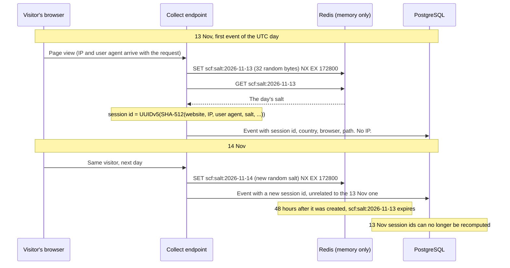

Lumenstat counts visits to a project's website and calls to its API without tracking the people behind them. It sets no cookies on the sites it measures, never stores an IP address, and keeps no spans, logs or request bodies from APIs. Every stored website record is keyed by a hash whose salt is deleted within 48 hours, after which no one, the operator included, can link it to a person.

<Warning>
**Draft pending counsel review.** This page summarizes the privacy statement in [`PRIVACY.md`](https://github.com/boundlessfi/lumenstat/blob/main/PRIVACY.md), which is a draft. A privacy lawyer reviews it in Milestone 1, and the reviewed text replaces the draft. Both describe what the code does today. Anything marked planned is not built yet.
</Warning>

## Who is who

- **Projects** (tenants) choose to measure their own websites and APIs. For their visitors' data they are the controller.
- **The Lumenstat operator** runs the service on the projects' behalf and processes that data only to produce their numbers. During the grant period the operator is the Boundless team. After handover it is the community operator that SCF names.
- **SCF operators** see aggregate numbers for every project, and summaries of flagged traffic, to assess usage.

## How it works

When the tracker sends an event, the collect endpoint sees the visitor's IP address and user agent as part of the HTTP request. It holds them in memory for that request only and uses them for four things:

1. **Country.** The IP is cut to its /24 (IPv4) or /48 (IPv6) network before the geo lookup, so the lookup never sees the full address. Region and city are never derived.
2. **Visitor hash.** The full IP and user agent are hashed with the website id and a random salt that changes every UTC day. The hash becomes the stored session id.
3. **Bot checks.** The full IP is compared in memory against published cloud and hosting ranges, and turned into two HMACs for the per-network visitor counter. See [Bot and inflation defense](/trust/bot-defense).
4. **Client type.** The user agent is reduced on the server to a browser name, an OS and a device type.

Then both are discarded. The event that reaches PostgreSQL holds the session id, the country and the coarse client fields, never the IP or the raw user agent. Caller-supplied `ip`, `userAgent`, `browser`, `os` and `device` fields in the payload are ignored, so the IP and the client fields always come from the request itself.

### The daily salt

Upstream Umami derives its session salt from the date and the server's `APP_SECRET`. Anyone holding that secret can recompute a visitor's session id from a known IP address and user agent, for as long as the data is kept. Lumenstat replaces it with a random salt per UTC day that is never written to disk.



The details, from [patch 0002](https://github.com/boundlessfi/lumenstat/tree/main/patches/umami) (`SCF_RANDOM_DAILY_SALT`):

- **Random, not derived.** Each salt is 32 bytes from Node's `crypto.randomBytes`, stored as 64 hex characters under `scf:salt:<UTC date>`. Nothing about the date or the app secret predicts it.
- **One salt per day across instances.** The salt is written with `SET … NX`, so the first instance to see a new day creates it and every instance then reads the same value.
- **Deleted after 48 hours.** The key is created with a 48-hour expiry (`EX 172800`). A salt is created by the first event of its day, so it always outlives that day. Every event becomes unlinkable at most 48 hours after it was recorded.
- **Memory only.** Redis runs with `--save ""` and `--appendonly no`, so no snapshot or log ever holds a salt. It also runs with `--maxmemory-policy noeviction`, so a salt is never evicted before its time. The salt is never written to PostgreSQL.

{/* TODO: confirm why the TTL is 48 hours rather than 24 hours plus a margin (for example, events that arrive late or carry their own timestamp), and state the reason here. */}

The session id itself is computed as:

```text
session id = UUIDv5( SHA-512( website id + IP + user agent + daily salt + distinct id + SHA-512(APP_SECRET) ) )
```

The distinct id is empty unless the site calls `umami.identify()`. See [Limits](#limits).

### Why stored records cannot identify a person after 48 hours

A stored website event holds a session id, a country, coarse client fields, the page and the referrer. The session id is the only field derived from the IP address. To connect it to a person, someone must take a candidate IP address and user agent and recompute the hash, which needs that day's salt.

- **The salt is gone.** After its 48-hour expiry the salt exists nowhere: not in PostgreSQL, not on disk, not in a backup. It is 256 random bits, so it cannot be guessed. Holding the database and `APP_SECRET` together is no longer enough to test whether a given IP and user agent visited.
- **Days do not link.** Each day has its own salt, so the same visitor gets unrelated session ids on different days. There is no visitor history to rebuild.
- **Sites do not link.** The website id is part of the hash, so the same visitor gets unrelated session ids on different sites, even within one project. There is no cross-site profile.
- **No IP to fall back on.** The IP is never stored, and the country comes from the truncated network.

## What is collected

### Website visitors

| Data | What happens | Kept |
| --- | --- | --- |
| IP address | Used in memory for one request: cut to /24 or /48 for the country lookup, hashed into the session id, checked against data-center ranges, turned into HMACs for the per-network counter. Then discarded. | Never stored |
| User agent | Reduced to browser, OS and device type, and hashed into the session id. The raw string is discarded. | Never stored |
| Country | Looked up from the truncated IP. Region and city are never derived. | With the event |
| Browser, OS, device type | Derived from the user agent on the server. | With the event |
| Screen size, language | Sent by the tracker, for example `1440x900` and `en-US`. | With the event |
| Session id | Website + IP + user agent + the day's random salt, hashed. Unlinkable once the salt expires. | With the event |
| Page and referrer | Page path and title, and the referrer. Query strings are removed except `utm_*` campaign tags. Ad click ids such as `gclid` and `fbclid`, and referrer query strings, are dropped. | With the event |
| Custom events | The event name and any event data the site sends with `umami.track()`. | With the event |
| Daily salt | 32 random bytes per UTC day, in Redis memory. | 48 hours, never on disk |
| Network counters | HMACs of the visitor's network and of the visitor, keyed by the daily salt, in Redis memory. | 2 hours, never on disk |
| Flagged events | Events that fail the bot and inflation checks: path, hostname, referrer domain, country, browser, OS, device, event name and the reasons. No IP, no user agent, no query string. | With the event |
| Cookies, local storage | None set, none written. | Nothing stored |

<Note>
**Planned: retention.** Events are to be kept 25 months, then reduced to daily totals. The retention job ships with Milestone 3. Until then nothing is deleted automatically. A project can ask for a site's data to be deleted for any date range today; self-service deletion is planned for Milestone 3.
</Note>

{/* TODO: PRIVACY.md does not list screen size, language, page title, URL fragments or custom event data. They are stored by Umami's collect endpoint (src/app/api/send/route.ts). Raise with counsel so the statement matches the code. */}

### API traffic

Projects send OpenTelemetry data to the collector with an ingest key. The collector keeps only what is needed for request counts and latency, then drops the rest. See [the collector](/api/collector) for the pipeline.

| Data | What happens | Kept |
| --- | --- | --- |
| Spans and traces | Server spans become request counts and latency histograms per route, method and status code. Then every span is dropped. | Never stored |
| Logs | Dropped on arrival. | Never stored |
| Metrics | Only `http.server.request.duration`, `http.server.duration` and `traces.span.metrics.duration` pass. Everything else is dropped. | As per-minute counters |
| Routes | Taken from `http.route`, or normalized from the raw path: Stellar addresses, ids, hashes and tokens become placeholders such as `{account}` and `{id}`. Query strings and fragments are removed. | With the counters |
| Caller IP addresses, headers, bodies | Not kept. The only header the collector uses is the ingest key, to pick the tenant. | Never stored |
| Ingest key | Picks the tenant. Stored only as a SHA-256 hash; a revoked key stays marked as revoked. | As a hash only |
| Per-minute counters | Tenant, service name, route, method, status code, minute, request count, duration sum and latency bucket counts. Nothing else reaches storage. | 30 days, then rollups for 36 months (planned) |

The collector buffers data in memory only, on its way to the writer.

<Note>
**Planned: API rollups and retention.** Hourly and daily rollups, and the retention job that enforces the 30-day and 36-month limits, ship with Milestone 1.
</Note>

### Dashboard users

People who sign in to the dashboard are project members and SCF operators.

| Data | What happens | Kept |
| --- | --- | --- |
| Account | An email address or username, and a bcrypt hash of the password. Projects that enroll themselves use the owner's email as the username. | Until the account is deleted |
| Session cookie | One strictly necessary cookie, `lumenstat_session`, on the dashboard's own domain. It is http-only, `Secure`, `SameSite=Lax`, and holds only the Umami session token. | 12 hours |
| Enrollment record | Project name, domains, one public Stellar link and the owner's email, so operators can review who enrolled. | No limit defined yet |

{/* TODO: confirm the retention period for enrollment records and dashboard accounts. */}

## Cloudflare in the pilot

<Warning>
In the current pilot, the tracker host (`t.lumenstat.com`) and the OTLP host (`otlp.lumenstat.com`) are served through Cloudflare. Cloudflare therefore processes visitors' IP addresses in transit, as a sub-processor.
</Warning>

Cloudflare's own country header (`cf-ipcountry`) is ignored: Umami runs with `SKIP_LOCATION_HEADERS=1`, so the country always comes from Lumenstat's lookup on the /24 or /48 network.

The production design serves `t.` and `otlp.` directly from EU servers, so no third-party CDN sees the IP addresses of visitors to project websites. Only the dashboard stays behind Cloudflare. This change is planned for Milestone 2 (see the [roadmap](/project/roadmap)).

## Where data lives

All storage and processing run on one server in the European Union (Germany), apart from Cloudflare's processing in transit during the pilot. PostgreSQL holds website events, flagged events, API counters, keys as hashes, and dashboard accounts. Redis holds the daily salts and the network counters, in memory only. The server publishes no ports: it is reached only through a Cloudflare Tunnel.

<Note>
**Planned: backups.** Off-site backups that stay in the EU ship with Milestone 2.
</Note>

### Sub-processors

| Sub-processor | Purpose | Data |
| --- | --- | --- |
| Cloudflare | DNS, TLS, and the tunnel to the server. In the pilot, also the tracker and OTLP hosts. | IP addresses and requests, in transit |
| EU hosting provider | Hosting | Everything listed on this page, at rest on the server |

{/* TODO: name the hosting sub-processor once counsel confirms the final sub-processor list. */}

## Legal basis (draft position)

<Note>
This section is the draft position in `PRIVACY.md`, not legal advice and not yet reviewed by counsel.
</Note>

### GDPR

Stored website records hold no personal data once the daily salt is deleted. The brief, in-memory use of the IP address rests on legitimate interest, Article 6(1)(f): measuring audience size and protecting projects against faked traffic, with no profiling and no cross-site tracking.

### ePrivacy

Lumenstat stores nothing on the visitor's device: no cookies, no local storage, no other storage. The tracker inherits one read from Umami: it checks the local storage key `umami.disabled`, an opt-out switch a visitor or site can set, and never writes it. Some EEA regulators read Article 5(3) of the ePrivacy Directive as covering cookieless scripts (EDPB Guidelines 2/2023). Member states without an audience-measurement exemption may still require consent. Counsel will name them, and this section will list them.

{/* TODO: PRIVACY.md says Lumenstat "reads and stores nothing" on the device, but the tracker reads localStorage["umami.disabled"]. Raise in the counsel review. */}

## Requests about your data

**Website visitors.** Stored data cannot identify you, so there is usually nothing to match a request to (GDPR Article 11). Write to the project whose site you visited, or [open an issue](https://github.com/boundlessfi/lumenstat/issues) in the repository.

**Dashboard users.** You can ask for your account to be exported or deleted by opening an issue or by contacting the operator listed on [lumenstat.com](https://lumenstat.com).

## Limits

- **What a site sends is stored as sent.** Lumenstat does not inspect page titles, URL paths, custom event names and data, or values passed to `umami.identify()`. If a site puts an email address or a user id in any of them, Lumenstat stores it. A distinct id from `identify()` is stored with the session and links that person's visits across days. Keep personal data out of these fields.
- **URL fragments are kept.** Query strings are stripped, but the `#fragment` is stored with the path. If your pages carry tokens or ids in fragments, add `data-exclude-hash="true"` to the tracker script.
- **The 48-hour window.** While a salt exists, someone with live access to Redis, the database and `APP_SECRET`, plus a candidate IP address and user agent, could test whether that visitor appears in that day's data. Only the operator's own infrastructure holds all three, and Redis is not reachable from outside the server.
- **Coarse fields can still single someone out.** On a site with very few visitors, country, browser, OS, device, screen size and timestamps together may point to one person for someone who already knows they visited.
- **A Redis restart splits the day.** The salt is never written to disk, so a restart loses it and a new one is drawn. Visitors seen before and after the restart count as different visitors that day.
- **Cloudflare sees IPs in transit** during the pilot, as described above.
- **Retention jobs are not built.** Until Milestones 2 and 3, nothing is deleted automatically.
- **This is a draft.** The legal position has not been reviewed by counsel.
