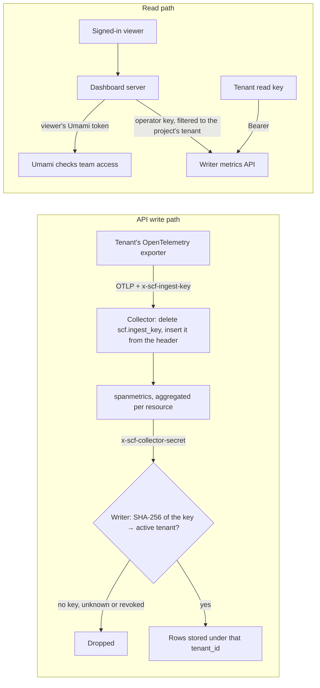

Lumenstat is one shared service for many SCF projects, so the failure that matters most is one project reading or changing another's numbers. Every read and every write is tied to a credential that names one project: an Umami session for website data, a hashed key for API data. Nothing a client puts in a payload can choose which project the data lands in.

## How it works

A project is an Umami team. Its websites belong to that team in Umami, and its API data belongs to an API tenant in the writer that is linked to the same team. The two paths are enforced by different components:

| | Write | Read |
| --- | --- | --- |
| **Website data** | Public website id, guarded by the [bot and inflation checks](/trust/bot-defense) | The viewer's own Umami token. Umami decides what it can see. |
| **API data** | Ingest key, stamped onto the data by the collector and resolved by the writer | Read key scoped to one tenant, or the dashboard's operator key filtered to the viewer's project |



## Website data

### Reads use the viewer's own token

- **The cookie holds only a token.** Signing in sets `lumenstat_session`, an http-only cookie with the viewer's Umami token and nothing else. It lasts 12 hours.
- **Identity is checked on every request.** The dashboard asks Umami who the token belongs to, whether they are an admin and which teams they belong to. It never reads roles or teams from the cookie.
- **Project pages check membership.** A project id in the URL must be one of the viewer's teams, or the viewer must be an Umami admin. Otherwise the page is a 404, not a hint that the project exists.
- **Umami enforces access to the numbers.** Website stats, page views and top lists are fetched from Umami with the viewer's own token. Umami checks team access on every call, so a mistake in the dashboard cannot return another team's website data.
- **Operator screens are for Umami admins only.** Everyone else gets a 404. SCF operators are Umami admins and see every project by design.

Flagged-traffic summaries on a project's **Website** page are the one exception. They come from an admin-only Umami endpoint, read with the Umami admin account over the private network, and are filtered in the dashboard's server code to the project's own website ids.

The code is in [`apps/dashboard/src/lib/server/viewer.ts`](https://github.com/boundlessfi/lumenstat/blob/main/apps/dashboard/src/lib/server/viewer.ts) and [`projects.ts`](https://github.com/boundlessfi/lumenstat/blob/main/apps/dashboard/src/lib/server/projects.ts).

### Writes are guarded by the bot checks

Website ids are not secrets: every page's snippet contains one. Anyone can post an event with your website id, so the boundary for writes is the [bot and inflation defense](/trust/bot-defense), not a credential. Layer 1 requires the browser's `Origin` to be one of your site's domains, so a page on another domain that copies your id is flagged, not counted. Scripts that forge the headers face layers 2 to 4.

The session token that the collect endpoint returns to the tracker is signed with the server's secret and bound to one website id. A token presented with a different website id is ignored.

## API data

### Writes: the ingest key picks the tenant

<Steps>
  <Step title="The tenant sends OTLP with its ingest key">
    The tenant's exporter adds the header `x-scf-ingest-key`. See [the collector](/api/collector).
  </Step>
  <Step title="The collector stamps the key onto the resource">
    Before anything else, the `resource/tenant` processor deletes any `scf.ingest_key` resource attribute the client sent, then inserts the value of the request header. A tenant cannot claim another tenant's key by writing it into the payload.

    ```yaml
    resource/tenant:
      attributes:
        - key: scf.ingest_key
          action: delete
        - key: scf.ingest_key
          from_context: metadata.x-scf-ingest-key
          action: insert
    ```
  </Step>
  <Step title="Spans are aggregated per tenant">
    The processor runs before `spanmetrics` turns spans into request counts and latency histograms. `spanmetrics` aggregates per resource, and the key is now part of the resource, so spans from different tenants are never merged into one series.
  </Step>
  <Step title="Only the collector can write to the writer">
    The collector sends to the writer with the header `x-scf-collector-secret`. The writer compares it in constant time and answers 401 to anything else. It refuses to start if the secret is shorter than 16 characters.
  </Step>
  <Step title="The writer resolves the key to a tenant">
    The writer hashes each key with SHA-256 and looks it up among unrevoked keys of active tenants. Data with no key, an unknown key or a revoked key is dropped, counted as `unknown_ingest_key`. The tenant id on a stored row comes only from this lookup.
  </Step>
</Steps>

The writer has no public route at all. In the reference deployment the only hostnames on the internet are the dashboard, the tracker and collect endpoint, and the OTLP endpoint (see [below](#umami-admin-and-the-writer-are-not-on-the-internet)). The collector secret is a second lock behind that one.

The configuration is in [`apps/collector/config.yaml`](https://github.com/boundlessfi/lumenstat/blob/main/apps/collector/config.yaml), and the writer side in [`apps/writer/src/server.ts`](https://github.com/boundlessfi/lumenstat/blob/main/apps/writer/src/server.ts) and [`ingest.ts`](https://github.com/boundlessfi/lumenstat/blob/main/apps/writer/src/ingest.ts).

### Reads: scoped read keys

The [metrics API](/reference/metrics-api) takes a read key as a Bearer token. A key either belongs to one tenant or is an operator key.

| Request | Tenant read key | Operator key |
| --- | --- | --- |
| `GET /v1/api-metrics/tenants` | Only its own tenant | Every tenant |
| `GET /v1/api-metrics/tenants/:id/routes` for its own tenant | The routes | The routes |
| `GET /v1/api-metrics/tenants/:id/routes` for another tenant | `404 tenant not found` | The routes |

The 404 for another tenant is the same answer as for a tenant id that does not exist, so a tenant key cannot be used to find out which tenant ids are real. Revoked and expired keys get a 401. Each successful use records the key's last-used time.

In the dashboard, the **API** and **Overview** pages read the writer with the dashboard's operator key. The dashboard looks up the tenant linked to the project's Umami team on the server and requests only that tenant's routes. The tenant id never comes from the browser.

Issuing a new ingest key from the **Setup** page is limited to the project's owner and managers.

## Keys are stored as SHA-256 hashes

Ingest keys and read keys are generated the same way:

```text
scf_ingest_<24 random bytes, base64url>
scf_read_<24 random bytes, base64url>
```

- **Shown once.** The full key is returned when it is created and never again.
- **Stored as a hash.** The database holds only the SHA-256 of the key, in hex. A copy of the database does not contain a usable key.
- **Why SHA-256 and not bcrypt.** Slow, salted hashes protect human passwords, which are guessable. These keys are 192 random bits, so there is nothing to guess, and a slow hash would only slow down every ingest batch. A fast hash keeps the lookup cheap while leaking nothing useful.
- **The prefix names the kind of key**, so a leaked key is recognizable wherever it turns up.
- **More than one ingest key per tenant.** Issuing a new key does not disable the old ones, so a project can rotate without a gap.

## Umami admin and the writer are not on the internet

The server publishes no ports. The only way in is a Cloudflare Tunnel, and the tunnel routes three hostnames to three services, with every other request answered by a 404:

| Hostname | What is routed | Service |
| --- | --- | --- |
| `app.lumenstat.com` | Everything | Dashboard |
| `t.lumenstat.com` | The tracker files and the collect endpoints only | Umami |
| `otlp.lumenstat.com` | OTLP over HTTP: traces, metrics and logs | Collector |

The path rules, from [`deploy/README.md`](https://github.com/boundlessfi/lumenstat/blob/main/deploy/README.md):

```text
t.lumenstat.com      ^/(script\.js|api/send|e|v/[0-9]+\.[0-9]+\.[0-9]+/l\.js)$
otlp.lumenstat.com   ^/v1/(traces|metrics|logs)$
anything else        404
```

Umami's login page, admin UI and API, and the writer, answer only on the stack's private network. The dashboard reaches them there. On a first deploy, Umami's default admin password is replaced over that private network before the tunnel starts, so the stack is never reachable with default credentials.

## Limits

- **Operator credentials sit behind two dashboard views.** API numbers and flagged-traffic summaries reach the dashboard through an operator key and the Umami admin account, and are filtered to the viewer's project in the dashboard's server code. Website numbers do not depend on that filter, because Umami checks the viewer's own token. A bug in the filter could expose another project's API numbers or flagged counts.
- **The collector accepts data before checking the key.** Keyless or wrong-key data is processed in memory by the collector and dropped at the writer. It never lands under a tenant, but it costs collector work. Checking keys at the edge is planned for Milestone 2 (see the [roadmap](/project/roadmap)).
- **An ingest key is a bearer secret.** Whoever holds a project's ingest key can write API metrics into that project. Keep it in your server's secrets, not in client code.
- **Revocation is slow to bite and partly manual.** The writer caches each ingest key lookup for 60 seconds, so a revoked key keeps working for up to a minute. Read keys are revoked with `npm run key:revoke` in `apps/writer`. Ingest keys have no revoke command or dashboard control yet.
- **Website writes have no credential.** Anyone can post events for a public website id. Whether they count is decided by the bot checks, with the limits described there.
- **Operators see everything.** SCF operators and operator keys see every project's numbers. That is the purpose of the operator view, not a leak.

{/* TODO: confirm how an operator revokes an ingest key today (the writer honors revoked_at, but no CLI or dashboard action sets it), and whether a command is planned. */}
