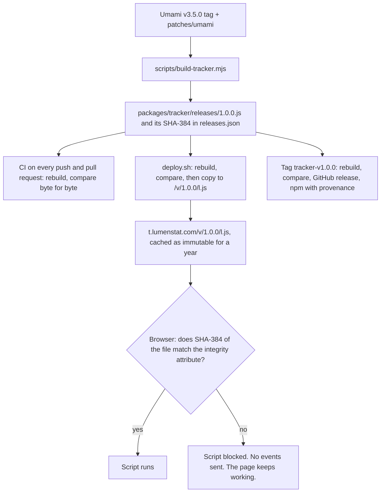

The tracker is the only Lumenstat code that runs on your visitors' devices, and it runs with your page's privileges. Each release lives at its own URL, never changes, and has a SHA-384 hash that your page pins with Subresource Integrity, so a modified file does not run. Anyone can rebuild a release from the repository and get the same bytes, and CI and every deploy check that they do.

## How it works



## Immutable versioned URLs

Every release is served at its own path, `https://t.lumenstat.com/v/<version>/l.js`, and the bytes at that path never change. A fix ships as a new version at a new path.

| Release | Value |
| --- | --- |
| URL | `https://t.lumenstat.com/v/1.0.0/l.js` |
| Size | 10,447 bytes |
| Integrity | `sha384-cBzCCJcHCWSGbuy/f+zavGm/HjUWv77eni4DyLfq+FfKigpin1mul1ekLXILze/3` |
| Built from | Umami `v3.5.0` plus the patches in `patches/umami` |
| Released | 13 November 2026 |

The record of every release is [`packages/tracker/releases.json`](https://github.com/boundlessfi/lumenstat/blob/main/packages/tracker/releases.json). The file itself is `packages/tracker/releases/<version>.js`, which is never edited after release. On each deploy, [`scripts/stage-tracker-releases.sh`](https://github.com/boundlessfi/lumenstat/blob/main/scripts/stage-tracker-releases.sh) copies every release into Umami's public folder, so older versions keep being served next to new ones.

Responses under `/v/` carry two headers, set by the Umami patch:

```http
Cache-Control: public, max-age=31536000, immutable
Access-Control-Allow-Origin: *
```

- **One-year immutable cache.** `max-age=31536000` is one year, and `immutable` tells browsers not to revalidate even on reload. That is safe only because the bytes at a versioned URL never change.
- **CORS for everyone.** Subresource Integrity on a script from another origin needs a CORS request, and a CORS request needs the response to allow the page's origin. `*` allows every site that embeds the tracker.

## Subresource Integrity

The snippet on your **Setup** page pins the release with its hash:

```html
<script
  defer
  src="https://t.lumenstat.com/v/1.0.0/l.js"
  integrity="sha384-cBzCCJcHCWSGbuy/f+zavGm/HjUWv77eni4DyLfq+FfKigpin1mul1ekLXILze/3"
  crossorigin="anonymous"
  data-website-id="YOUR-WEBSITE-ID"
></script>
```

The browser downloads the file, computes its SHA-384, and compares it with the `integrity` attribute before running anything. On a mismatch it does not execute the script, fires an `error` event on the `<script>` element, and logs an integrity error in the console. No event is sent from that page until the file and the hash agree again. The rest of your page keeps working, except code that calls `umami.track()` directly, which finds no `umami` object.

`crossorigin="anonymous"` is required. Without it, the browser fetches the script in no-cors mode, cannot read the response to check it, and blocks it.

**What it protects against.** A changed file on Lumenstat's servers, on Cloudflare, or anywhere in between. Someone who takes over `t.lumenstat.com` still cannot run different code on your pages through the pinned URL.

Check the hash yourself:

```bash
curl -s https://t.lumenstat.com/v/1.0.0/l.js | openssl dgst -sha384 -binary | openssl base64 -A
```

The output must equal the part of the integrity value after `sha384-`, in your snippet and in `releases.json`.

## Reproducible build

A hash only proves that the file has not changed since it was hashed. The reproducible build proves where the file came from: anyone can rebuild a release from the repository and get the same bytes, so the code you can read is the code you run.

[`scripts/build-tracker.mjs`](https://github.com/boundlessfi/lumenstat/blob/main/scripts/build-tracker.mjs) builds the tracker from fixed inputs:

- Umami's source at the tag `v3.5.0`, cloned by [`scripts/sync-umami.sh`](https://github.com/boundlessfi/lumenstat/blob/main/scripts/sync-umami.sh), with the patches in `patches/umami` applied as `git format-patch` files.
- Dependencies from Umami's lockfile, installed with pnpm `12.3.4` and `--frozen-lockfile`.
- Umami's own Rollup configuration for the tracker.
- The collect host and path from `packages/tracker/package.json`: `https://t.lumenstat.com` and `/e`.

With `--check`, the script rebuilds the tracker and compares it byte for byte with `packages/tracker/releases/<version>.js`. It writes nothing. It exits with an error if the bytes differ or if the release file is missing. Without `--check`, it refuses to overwrite a released version whose build has changed: changing the tracker means bumping the version.

`--check` runs in three places:

| Where | When | If the bytes differ |
| --- | --- | --- |
| CI, [`.github/workflows/ci.yml`](https://github.com/boundlessfi/lumenstat/blob/main/.github/workflows/ci.yml) | Every push to `main` and every pull request, after the patches are applied to the pinned tag and the SCF patch tests pass | The check fails |
| [`deploy/deploy.sh`](https://github.com/boundlessfi/lumenstat/blob/main/deploy/deploy.sh), and the Ansible role that mirrors it | Before every deploy, before releases are staged | Nothing is deployed |
| The release workflow | Before the GitHub release and the npm publish | Nothing is published |

Rebuild it yourself:

```bash
scripts/sync-umami.sh
(cd vendor/umami && npx -y pnpm@12.3.4 install --frozen-lockfile --ignore-scripts)
node scripts/build-tracker.mjs --check
# Tracker 1.0.0 rebuilds byte for byte (sha384-cBzCCJcH...).
```

## npm provenance

The tracker is also published to npm as `@lumenstat/tracker`, for teams that host the file themselves. The package holds `dist/l.js`, which is copied from `releases/<version>.js` when the package is packed, plus `releases.json` and a README.

It is published only by the release workflow, with `npm publish --provenance` and npm trusted publishing over GitHub's OIDC token. Provenance is a signed, publicly logged statement that links the package to the repository, the commit and the workflow run that built it. In a project that installs the package, check it with:

```bash
npm audit signatures
```

<Note>
**Planned: first npm publish.** `@lumenstat/tracker` is ready and the workflow is in place, but the first publish is pending, as part of Milestone 1. Until then, use the hosted URL.
</Note>

## The release workflow

[`.github/workflows/release-tracker.yml`](https://github.com/boundlessfi/lumenstat/blob/main/.github/workflows/release-tracker.yml) runs when a tag `tracker-v<version>` is pushed.

<Steps>
  <Step title="Build the new version">
    Bump `version` in `packages/tracker/package.json`, then run `node scripts/build-tracker.mjs`. It writes `releases/<version>.js` and adds the URL, integrity hash, size, Umami tag and release date to `releases.json`. Commit both.
  </Step>
  <Step title="Push the tag">
    Push `tracker-v<version>`. The workflow stops if the tag does not match the version in `package.json`.
  </Step>
  <Step title="Rebuild from source">
    The workflow applies the patches to the pinned Umami tag, installs dependencies with `--frozen-lockfile --ignore-scripts`, and runs `build-tracker.mjs --check`. A release that does not rebuild byte for byte stops here.
  </Step>
  <Step title="Publish the release">
    It writes release notes with the URL, the integrity hash, the snippet and the `curl` check, and creates a GitHub release with the file attached.
  </Step>
  <Step title="Publish to npm">
    It runs `npm publish --provenance --access public`. The job holds `contents: write` to create the release and `id-token: write` for provenance, and nothing else.
  </Step>
</Steps>

## Upgrading is a deliberate change

A new tracker version has a new URL and a new hash. Nothing changes on your site until you edit the snippet. That is on purpose:

- **With a pinned URL and hash, Lumenstat cannot change what runs on your pages.** A service that can push new code into every enrolled site at once is a supply-chain risk for all of them. Here a new version runs only where a project has chosen it.
- **A pinned hash would block an in-place change anyway.** If the bytes at a URL changed, every site using SRI would stop sending events. Versioned URLs make that impossible to do by accident.
- **Security fixes ship the same way.** A fix to the tracker is a new version, listed in `releases.json`, and enrolled projects are told to upgrade. See the [security policy](/trust/security-policy#supported-versions).

The list of versions is in [Tracker releases](/reference/tracker-releases).

## Ad-block-safe paths

Umami serves its script at `/script.js` and collects at `/api/send`, and ad-block filter lists target both paths. Lumenstat serves releases at `/v/<version>/l.js` and collects at `/e`. The collect path is built into the tracker at build time and rewritten to Umami's collect endpoint on the server, with `COLLECT_API_ENDPOINT=/e`.

This keeps generic path rules from silently dropping a project's numbers. It does not get around a visitor's choice: a list can still block the `t.lumenstat.com` hostname, and the tracker still honors `data-do-not-track` when a site sets it.

## CI actions pinned by commit SHA

Every third-party action in the workflows is pinned to a full commit SHA, with its version in a comment:

```yaml
- uses: actions/checkout@3d3c42e5aac5ba805825da76410c181273ba90b1 # v7.0.1
- uses: actions/setup-node@949feb2413d6458794dcd2491c4babbbce0c15c1 # v7.1.0
- uses: softprops/action-gh-release@8a0cd651e5b2365bd640854a3fa5dfc70e4875f3 # v3.0.4
```

A tag such as `v7` can be moved to different code by anyone who controls the action's repository. A commit SHA cannot. This matters most in the release job, which holds an OIDC token that can publish to npm with valid provenance: a compromised action there could publish a tampered package that still looks properly built.

The workflows also limit what runs and what it can do:

- CI runs with `permissions: contents: read`. Only the release job gets write permissions, as listed above.
- Dependencies are installed with `--ignore-scripts`, so no package's install script runs in CI.
- pnpm is pinned to `12.3.4`.

## Limits

- **SRI protects only pages that use it.** A snippet without the `integrity` attribute runs whatever the URL returns. If you host the file yourself from npm, the integrity of your copy depends on your own hosting.
- **The legacy `/script.js` path is still served** on `t.lumenstat.com`, alongside the legacy `/api/send`. It is Umami's unversioned build, not an immutable release, and not covered by this page. Use the versioned URL.
- **Upstream is fetched by tag name.** `sync-umami.sh` clones Umami's `v3.5.0` tag, not a commit SHA. If that tag were moved upstream, `--check` would catch any change to the tracker's bytes, but not changes to Umami's server code.
- **The build tools come from npm.** `npx -y pnpm@12.3.4` downloads pnpm at build time.
- **Reproducible is not reviewed.** A matching rebuild proves the file comes from the repository's source. It does not prove the source is safe. Read the changes to `patches/umami` and `releases.json` like any other code.
- **Provenance is not live yet.** The first npm publish is pending.
- **Upgrades are manual.** A project on an old version keeps it, fixes included, until it changes its snippet.
