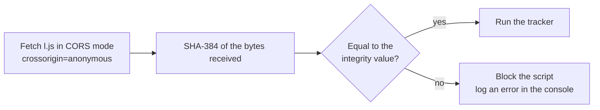

The `integrity` value in your snippet decides which bytes your visitors' browsers will run. You can check that it matches the published release with one command, and rebuild the file from source to check the release itself. If the file at the tracker URL ever changes, browsers refuse to run it and your pages keep working.

[Tracker supply chain](/trust/tracker-supply-chain) explains why the tracker is pinned this way and what each control protects against.

<Steps>
  <Step title="Hash the file the server sends">
    ```bash
    curl -s https://t.lumenstat.com/v/1.0.0/l.js | openssl dgst -sha384 -binary | openssl base64 -A
    ```

    For release 1.0.0 the output is:

    ```text
    cBzCCJcHCWSGbuy/f+zavGm/HjUWv77eni4DyLfq+FfKigpin1mul1ekLXILze/3
    ```

    This is the SHA-384 digest of the bytes in base64, the encoding the `integrity` attribute uses, without the `sha384-` prefix. `-binary` makes `openssl dgst` output raw bytes instead of hex, and `-A` keeps the base64 on one line. The file is 10,447 bytes: `curl -s https://t.lumenstat.com/v/1.0.0/l.js | wc -c` prints `10447`.
  </Step>

  <Step title="Compare it with releases.json">
    Every release is recorded in [`packages/tracker/releases.json`](https://github.com/boundlessfi/lumenstat/blob/main/packages/tracker/releases.json) when it is built:

    ```json packages/tracker/releases.json
    {
      "1.0.0": {
        "url": "https://t.lumenstat.com/v/1.0.0/l.js",
        "integrity": "sha384-cBzCCJcHCWSGbuy/f+zavGm/HjUWv77eni4DyLfq+FfKigpin1mul1ekLXILze/3",
        "bytes": 10447,
        "umami": "v3.5.0",
        "released": "2026-11-13"
      }
    }
    ```

    Your output must equal the `integrity` value after `sha384-`. The same hash appears in two other places, each produced independently:

    - **The Setup page.** The dashboard hashes the tracker file it fetches from the server each time **Setup** loads, and puts that hash in your snippet. It does not copy it from `releases.json`.
    - **The GitHub release notes** for the tag `tracker-v1.0.0`, written by the release workflow from `releases.json` after it rebuilds the file.

    If any of these disagree, do not ship the snippet. Report it as described in the [security policy](/trust/security-policy).

    {/* TODO: confirm the tracker-v1.0.0 GitHub release exists. The workflow (.github/workflows/release-tracker.yml) creates it in the same job as the npm publish, which is still pending. */}
  </Step>

  <Step title="Check what your site serves">
    Confirm that your deployed pages pin the same hash:

    ```bash
    curl -s https://example.org/ | grep -o 'sha384-[A-Za-z0-9+/=]*'
    ```

    For a site that injects the tag from JavaScript, such as Next.js with `next/script`, inspect the rendered `<script>` element in the browser's developer tools instead.
  </Step>

  <Step title="Rebuild it from source (optional)">
    This checks the release itself: that the published file is exactly what the source in the repository produces. You need git and Node.js 22 or later.

    ```bash
    git clone https://github.com/boundlessfi/lumenstat.git
    cd lumenstat
    scripts/sync-umami.sh
    (cd vendor/umami && npx -y pnpm@12.3.4 install --frozen-lockfile --ignore-scripts)
    node scripts/build-tracker.mjs --check
    ```

    `sync-umami.sh` clones Umami at the tag `v3.5.0` and applies the patches in `patches/umami`. `build-tracker.mjs --check` builds the tracker from that source with the collect host and endpoint recorded in `packages/tracker/package.json`, compares the result with `packages/tracker/releases/1.0.0.js` byte for byte, and writes nothing. A match prints:

    ```text
    Tracker 1.0.0 rebuilds byte for byte (sha384-cBzCCJcHCWSGbuy/f+zavGm/HjUWv77eni4DyLfq+FfKigpin1mul1ekLXILze/3).
    ```

    The same check runs in CI on every push to `main` and every pull request, in the release workflow before anything is published, and in the deploy script before every deploy.
  </Step>
</Steps>

## What the browser does if the bytes change



1. Because of `crossorigin="anonymous"`, the browser fetches the file in CORS mode. `t.lumenstat.com` answers tracker requests with `Access-Control-Allow-Origin: *`, so the browser can read the bytes and check them. Without the attribute, a browser cannot check a cross-origin file and blocks it.
2. The browser computes the SHA-384 hash of the bytes it received and compares it with the hash in `integrity`.
3. If they differ, the browser does not run the file, fires an `error` event on the `<script>` element and logs an integrity error in the console.

Nothing in your page depends on the tracker, so the page renders and works as before. No tracker code runs, so no events are sent, and page views on your dashboard stop until the snippet and the file agree again. The failure is closed: a changed file can stop your analytics, but it cannot run on your site.

A released file is never edited. It is served with `Cache-Control: public, max-age=31536000, immutable`, and a fix ships as a new version at a new URL with a new hash. Upgrading means changing `src` and `integrity` together, on purpose. [Tracker releases](/reference/tracker-releases) lists every version.

## Verify the npm package

<Note>
  The first npm publish of `@lumenstat/tracker` is pending (Milestone 1). These checks apply once it is published.
</Note>

The package's `dist/l.js` is copied from `releases/<version>.js` when the package is packed, so it has the same hash as the hosted file:

```bash
openssl dgst -sha384 -binary node_modules/@lumenstat/tracker/dist/l.js | openssl base64 -A
```

The package is published from GitHub Actions with npm provenance. `npm audit signatures` checks the registry signatures and provenance attestations of the packages installed in your project. [Self-host the tracker](/web/self-host-the-tracker) covers serving that file from your own domain.

## Limits

- **The browser enforces the hash you give it.** If you copy a hash from a tampered source, the browser enforces the wrong one. Compare at least two independent sources: the bytes the server sends and `releases.json` in the repository.
- **Integrity covers the tracker file only.** It says nothing about the collect endpoint or the dashboard.
- **A new version is new code.** Upgrading accepts a different file. Review what changed in `patches/umami` and the release notes before you change your snippet.
- **Browsers without Subresource Integrity support run the file unchecked.** All current major browsers support it.
